# Home Energy: SigenStor dashboard

[](https://github.com/copperOstrich/sigen-dashboard/releases/latest)
[](https://github.com/copperOstrich/sigen-dashboard/pkgs/container/sigen-dashboard)
[](https://github.com/copperOstrich/sigen-dashboard/actions/workflows/docker.yml)
[](LICENSE)

A local dashboard for a SigenStor system that reads the inverter
directly over **Modbus TCP**, so it keeps working when Sigenergy's cloud is down.
Live retailer prices from **Amber Electric** or **LocalVolts** add buy/sell prices, spike
warnings, forecasts and what your power is costing, and free **AEMO** market data shows
the wholesale price, demand and generation mix for your region. Free **Open-Meteo** weather
gives a local forecast and a **solar production forecast** that learns from your own panels.
If you have a **Sigen AC charger**, it shows the car charging too, with a log of every session.

<picture>
  <source media="(prefers-color-scheme: dark)" srcset="docs/screenshots/power-flow-dark.png">
  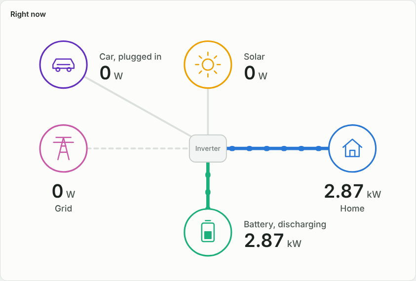
</picture>

```
                                          ┌── Amber or LocalVolts API (optional)
SigenStor ──Modbus TCP (read-only)──▶ Collector (Docker / Pi / NAS) ◀── AEMO market data
  (inverter, battery, AC charger)        │  SQLite history,      ◀── Open-Meteo weather (optional)
                                         │  web dashboard, JSON API
                     ┌───────────────────┼─────────────────────┐
              Browser dashboard    Installed as an app   Phone / tablet browser
```

* **Collector** (`collector/`): Python standard library only, no packages to install.
  Polls every 5 s, keeps minute history for ~2 years, serves the dashboard on port 8080.
* **Dashboard** (`web/`), in panels you can show, hide, reorder and resize:
  * live power flow between solar, battery, home, grid and car, with battery detail
  * today's totals, self-sufficiency and cost
  * battery outlook: will it last the night, when it fills again, and whether grid charging is worthwhile
  * weather, four-day forecast and a solar forecast in kWh
  * car charging from a Sigen AC charger: state, sessions, energy and cost
  * retailer and wholesale prices with forecasts, and the grid's generation mix
  * power and battery history, with a Today view
  * solar strings, sunrise to sunset, for spotting shading or a faulty string
  * daily energy and cost for the last 30 days, a monthly summary with a printable report,
    and trends over months (string output, insulation, battery health, temperatures)
  * system status, decoded alarms, insulation resistance check and an event log

  Light and dark mode, works on a phone, and shows the version you're running at the bottom.
* **Compact widget** (`/widget.html`): solar, home, battery and grid in a small window.
  The dashboard and the widget can each be installed as an app from Edge or Chrome, or added
  to a phone's home screen: see [On your computer or phone](#5-on-your-computer-or-phone).

It never writes to the inverter. The Modbus client has no write functions, so it can't
interfere with retailer battery control such as Amber SmartShift or a VPP.

## Quick start

You need a machine on your home network that stays on (a NAS, Raspberry Pi or mini PC)
with Docker installed.

```sh
mkdir sigen-dashboard && cd sigen-dashboard
docker run -d --name sigen-dashboard --restart unless-stopped \
  -p 8080:8080 -v "$PWD/data:/data" \
  -e SIGEN_SIMULATE=1 -e AEMO_REGION=NSW1 \
  ghcr.io/copperostrich/sigen-dashboard:latest
```

Open `http://<that-machine>:8080`. It starts on simulated data so you can look around.
Then point it at your inverter and add your retailer, either with `-e` settings or in a
`data/sigen.env` file (copy [`qnap/sigen.env.example`](qnap/sigen.env.example)):

```sh
SIGEN_SIMULATE=0
SIGEN_HOST=192.168.1.60      # your inverter's IP address (Modbus TCP must be enabled)
AMBER_API_KEY=...            # or LOCALVOLTS_API_KEY and LOCALVOLTS_PARTNER_ID
SITE_LAT=-33.87              # optional: for weather and the solar forecast
SITE_LON=151.21
SOLAR_KWP=10                 # optional: your array size in kW
```

Every setting is listed under [Settings](#settings).

Change settings later from the dashboard's **Settings** page (the gear, top right), or edit
`sigen.env` and restart the container. To have it as an app on your computer or
phone, see [On your computer or phone](#5-on-your-computer-or-phone).
On a QNAP, see [the ready-made setup](#ready-made-image-qnap-synology-unraid-portainer).

## Keep it on your home network

The dashboard has no login, and anyone who can reach it can see your energy data. Don't
forward its port on your router or expose it to the internet. To check in when you're
away, use a VPN to your home network (Tailscale, WireGuard, or your router's built-in VPN).
The collector only ever reads from the inverter, so the dashboard can't change any
settings, but your usage pattern is still personal information.

## Screenshots

Screenshots switch between light and dark to match your GitHub theme; both versions are in
[`docs/screenshots`](docs/screenshots). They were taken with the built-in simulator, so the
numbers are realistic but not from a real home.

The dashboard is ten panels; related things share a panel, with tabs.

**Battery**: charge, how long it lasts at this rate, cell temperature and voltage (Now), beside
cycles, energy through it against the warranty, round trip, and health and temperature over time
(Health). Shown side by side when the panel is full width, as here; as tabs when narrower.

<picture>
  <source media="(prefers-color-scheme: dark)" srcset="docs/screenshots/battery-dark.png">
  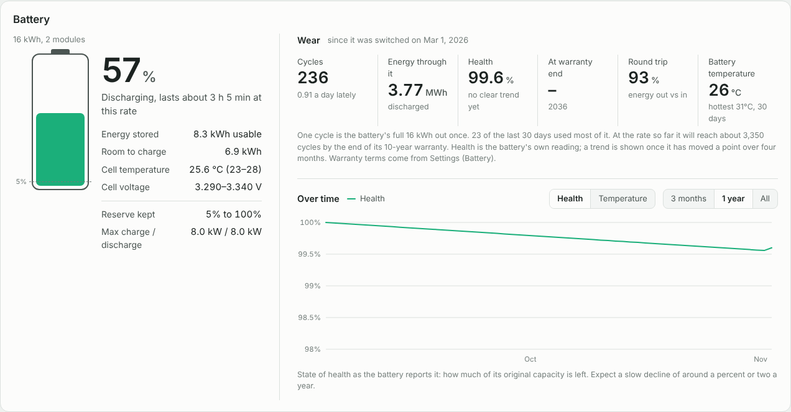
</picture>

**Forecast**: where the battery's charge is heading until the end of tomorrow, on one chart
with solar and home use (kW on the left, charge on the right), with plain answers (will it
last the night, what the grid will cost until sunrise, when solar fills it again), then the
weather and four days of solar forecast.

<picture>
  <source media="(prefers-color-scheme: dark)" srcset="docs/screenshots/forecast-dark.png">
  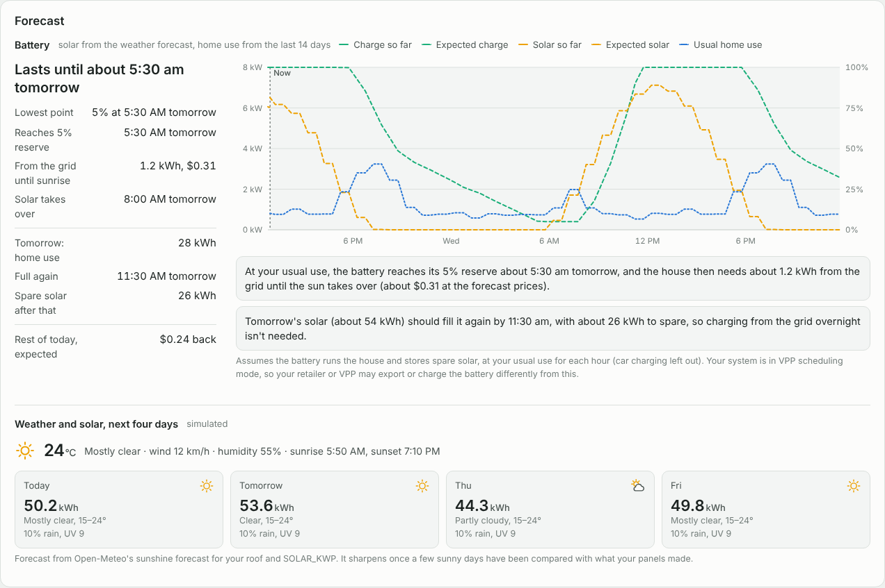
</picture>

**A good time to use power?** The indicator at the top says, from free to a price spike, how
good a time it is to use power, from what an extra kWh costs you right now: spare solar that
would otherwise be exported, battery energy (at what the house will pay later), or grid power.
Click it for why, how long it stays good or when the next good time is, any spike coming, the
scale, and the best times to run your appliances.

<picture>
  <source media="(prefers-color-scheme: dark)" srcset="docs/screenshots/goodtime-dark.png">
  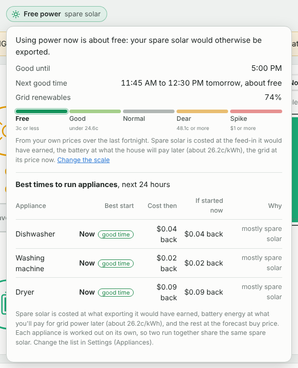
</picture>

**Car charging** (with a Sigen AC charger): the charger's state, this session, a 48-hour
timeline, recent sessions with what they cost and saved against a fuel car, and a charging plan.

<picture>
  <source media="(prefers-color-scheme: dark)" srcset="docs/screenshots/ev-charging-dark.png">
  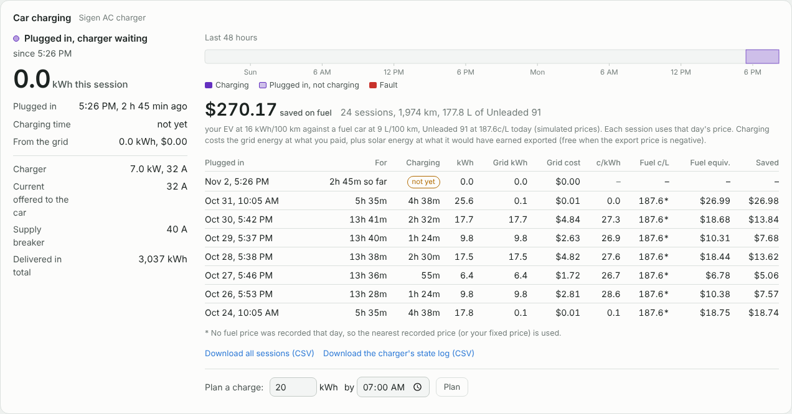
</picture>

**Prices and the grid**: your retailer's buy and sell price with a 24-hour forecast; **The grid**
has AEMO's wholesale price, your region's generation mix and every NEM region side by side.

<picture>
  <source media="(prefers-color-scheme: dark)" srcset="docs/screenshots/prices-grid-dark.png">
  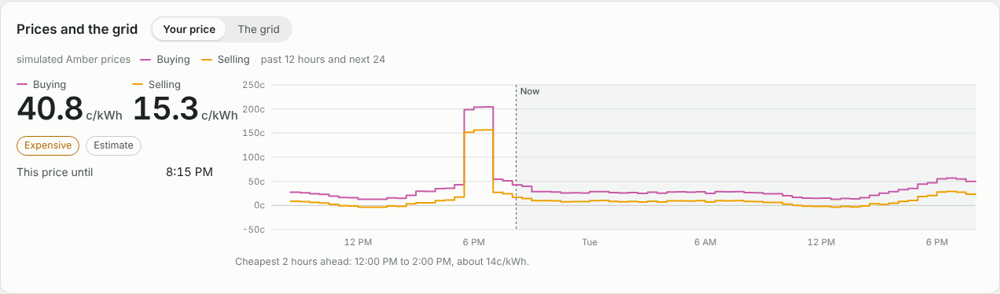
</picture>

**History**: power flows and battery charge from today to 30 days (**Power**), each day's energy
in and out (**Days**), each month against the same month last year with targets and a printable
report (**Months**), and what the house draws overnight (**Always-on**).

<picture>
  <source media="(prefers-color-scheme: dark)" srcset="docs/screenshots/history-dark.png">
  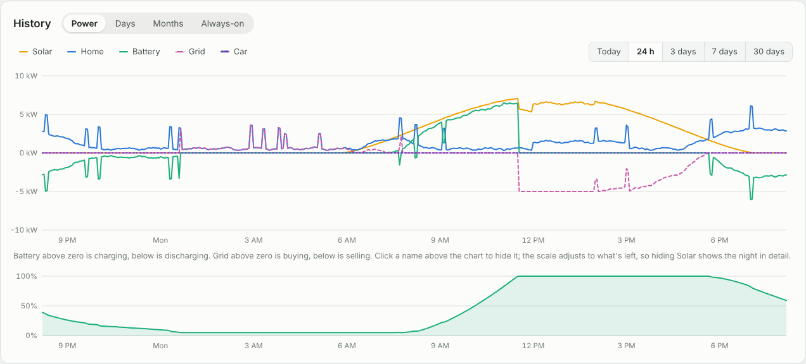
</picture>

<picture>
  <source media="(prefers-color-scheme: dark)" srcset="docs/screenshots/monthly-dark.png">
  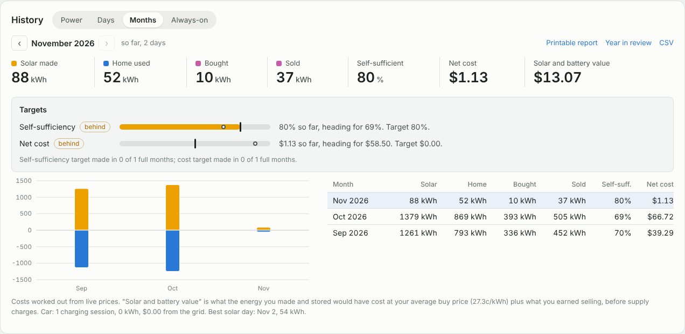
</picture>

**Solar**: power, voltage and current for each PV string with each one's share and peak
(**Strings**), solar held back and why (**Limits**), and the solar against the weather over the
seasons (**Long term**).

<picture>
  <source media="(prefers-color-scheme: dark)" srcset="docs/screenshots/strings-dark.png">
  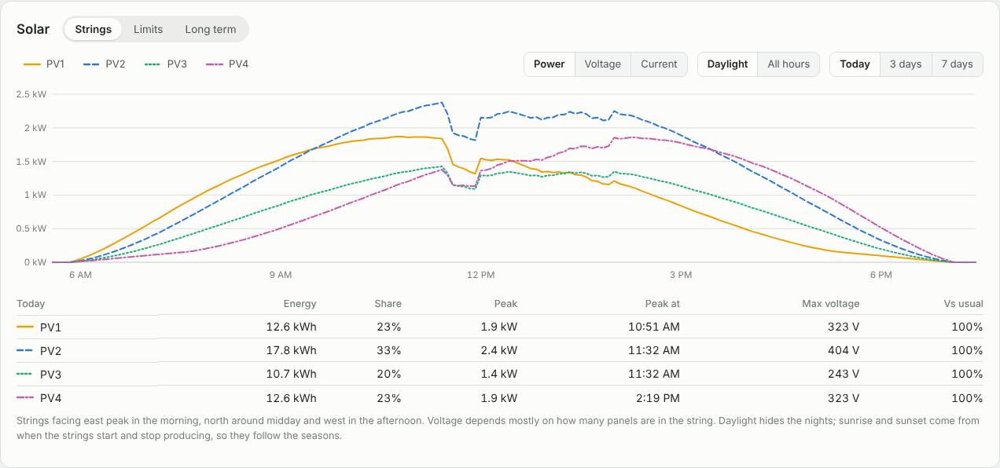
</picture>

**Money**: a year on each plan (your retailer, the Default Market Offer flat and time of use, or
your own quotes) with the battery run for each, and what more battery or panels would add
(**Plans**); how far the system is towards paying for itself (**Payback**); and price spikes caught
and missed, export prices and a higher backup reserve (**Trading**).

<picture>
  <source media="(prefers-color-scheme: dark)" srcset="docs/screenshots/money-dark.png">
  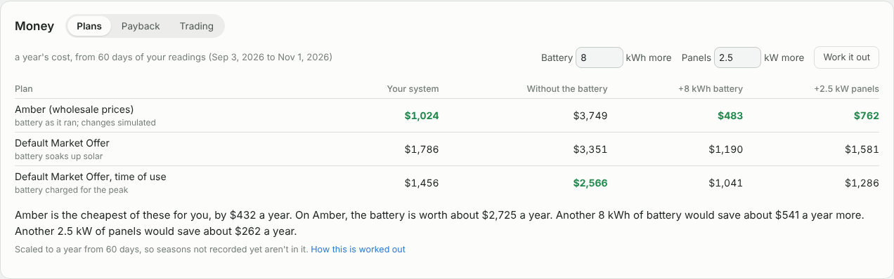
</picture>

<picture>
  <source media="(prefers-color-scheme: dark)" srcset="docs/screenshots/trading-dark.png">
  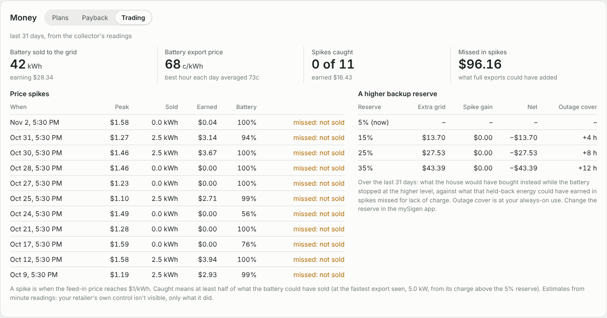
</picture>

**System**: inverter status, alarms, data feeds and recent events, beside insulation and
inverter temperature over time.

<picture>
  <source media="(prefers-color-scheme: dark)" srcset="docs/screenshots/system-dark.png">
  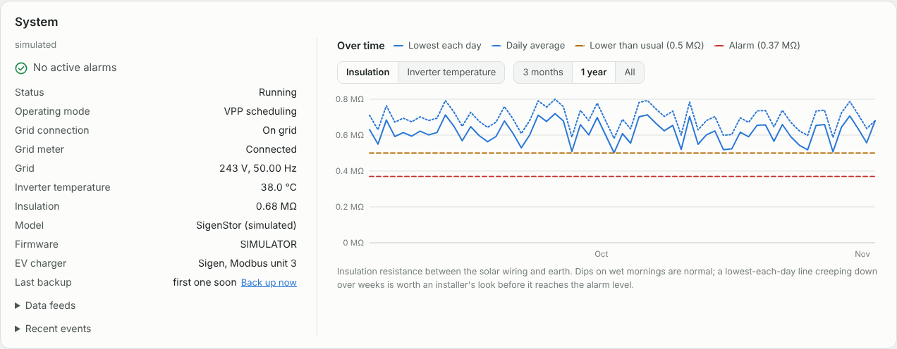
</picture>

**The grid, three ways**: all five regions as tiles with how full each interconnector is, as
nodes and wires coloured by price, or as a chain following how the grid connects. Pick one in
Settings.

<picture>
  <source media="(prefers-color-scheme: dark)" srcset="docs/screenshots/grid-map-dark.png">
  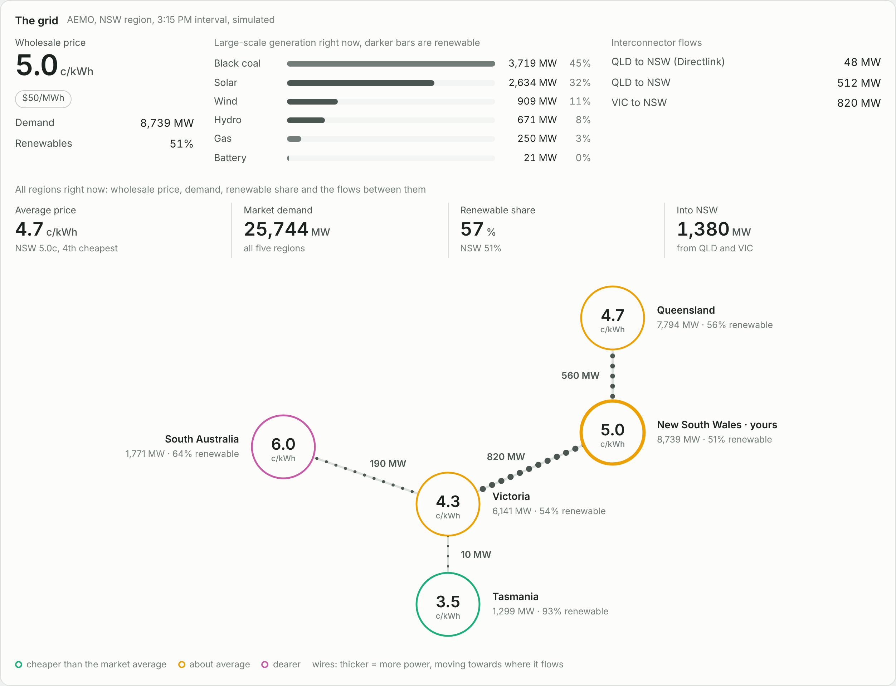
</picture>

**Year in review** (a link under History > Months): the last 12 months at a glance, with monthly
charts and highlights, printable to A4. The monthly **Printable report** also covers solar held
back, price spikes, always-on use and battery cycles for the month.

**Arrange panels**: hide what you don't use, and change the order and width of the rest.

<picture>
  <source media="(prefers-color-scheme: dark)" srcset="docs/screenshots/arrange-dark.png">
  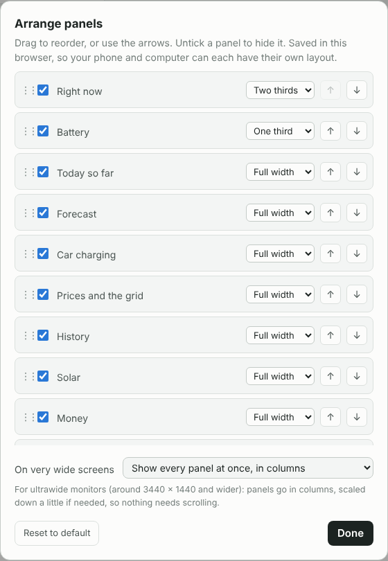
</picture>

**Settings** (the gear): every setting below, grouped, with what each one does. Saving writes
`sigen.env` in the data folder (the previous file is kept as `sigen.env.bak`, and your comments
stay) and restarts the collector, which takes a few seconds. Settings can only be changed from
a device on the collector's own network: from anywhere else the gear is greyed out, the page
is read-only, and API keys, addresses and your location are never sent. Keys are shown masked
at home too, with **Show** to reveal one. If the dashboard sits behind a reverse proxy, every
visitor looks local, so set `SETTINGS_EDIT_FROM` to the addresses allowed to make changes.

<picture>
  <source media="(prefers-color-scheme: dark)" srcset="docs/screenshots/settings-dark.png">
  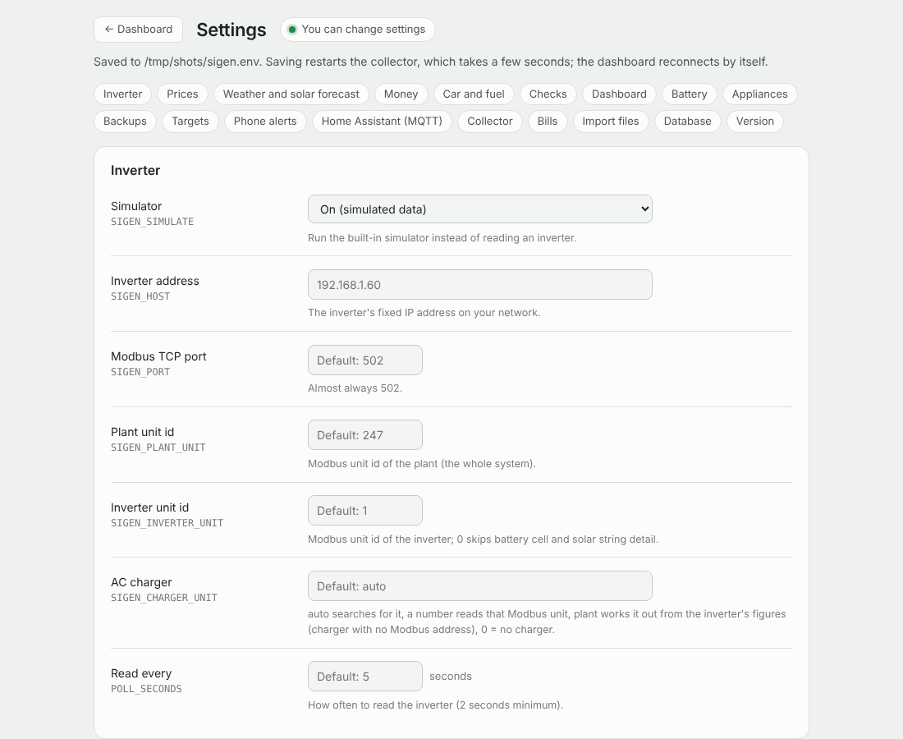
</picture>

**Compact widget and phone**: the small widget view (`/widget.html`), and the dashboard
on a phone.

<p>
<picture>
  <source media="(prefers-color-scheme: dark)" srcset="docs/screenshots/widget-dark.png">
  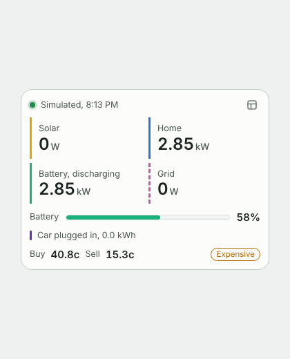
</picture>
&nbsp;
<picture>
  <source media="(prefers-color-scheme: dark)" srcset="docs/screenshots/phone-dark.png">
  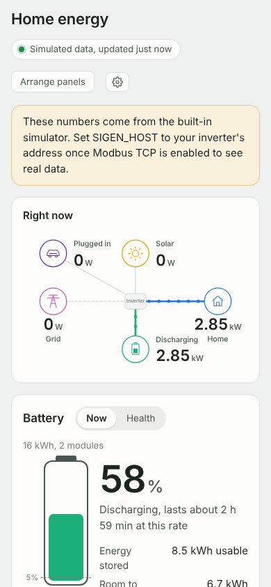
</picture>
</p>

<details>
<summary>The whole dashboard</summary>

<picture>
  <source media="(prefers-color-scheme: dark)" srcset="docs/screenshots/dashboard-dark.png">
  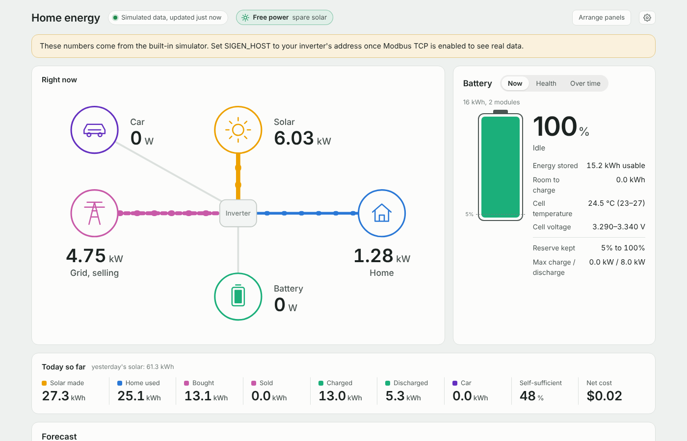
</picture>

</details>

## 1. Run the collector

On any always-on machine on your home network (NAS, Raspberry Pi, mini PC) with Docker:

```sh
cp .env.example .env        # edit it
docker compose up -d --build
```

Open `http://<that-machine>:8080`.

No Docker? Python 3.9+ is all it needs:

```sh
SIGEN_SIMULATE=1 python3 collector/sigen_collector.py          # simulated data
SIGEN_HOST=192.168.1.60 python3 collector/sigen_collector.py   # real system
```

### Ready-made image (QNAP, Synology, Unraid, Portainer)

GitHub builds an image for Intel/AMD and ARM: `ghcr.io/copperostrich/sigen-dashboard:latest`.
On a QNAP:
1. With File Station, save [`qnap/sigen.env.example`](qnap/sigen.env.example) as
   `/share/Container/sigen-dashboard/sigen.env` and fill it in.
2. Paste [`qnap/docker-compose.yml`](qnap/docker-compose.yml) into
   **Container Station → Applications → Create**.
3. Open `http://<NAS-IP>:8088`. It uses port 8088 because QTS's own admin page is on 8080.

To give the dashboard its **own address on your network** (so it's at
a plain address with no port, or a name you set up on your router's DNS), use
[`qnap/docker-compose.own-ip.yml`](qnap/docker-compose.own-ip.yml) instead; the comments at the
top say which three values to change.

History is kept in `/share/Container/sigen-dashboard`. To change a setting later, use the
dashboard's **Settings** page, or edit `sigen.env` and restart the container.

Any Docker host can do the same: every setting can go in a `sigen.env` file in the data
folder (mounted at `/data`), which is read on each start and overrides the container's
environment.

### Until Modbus TCP is available

Leave `SIGEN_SIMULATE=1`. A built-in simulator of an example home system (10 kWp solar,
16 kWh battery, 10 kW inverter, 5 kW export limit) serves the exact same Modbus
registers, so everything is exercised end to end. To make it resemble your own system,
set `SIM_PV_KWP`, `SIM_BATTERY_KWH`, `SIM_INVERTER_KW` and `SIM_EXPORT_LIMIT_KW`. It pre-fills 14 days of history and
the dashboard shows a "simulated data" banner. Simulated history is kept in a separate
database (`data/simulator.db`) and never mixes with real readings.

You can also run the simulator on its own as a fake inverter:
`python3 collector/simulator.py --port 5020`, then `SIGEN_HOST=127.0.0.1 SIGEN_PORT=5020`.
`SIM_ALARMS="alarm1:9"` sets alarm bits so you can see how alarms look.

### Switching to the real system

1. **Enable Modbus TCP server** on the SigenStor. This is in the mySigen app's
   communication settings and usually needs the **installer account**, so you may
   need to ask your installer. Make sure they tap Save.
2. Give the inverter a **fixed IP** (DHCP reservation in your router).
3. In `.env`: `SIGEN_SIMULATE=0`, `SIGEN_HOST=<inverter IP>`, then
   `docker compose up -d`.

Defaults match Sigenergy's protocol: port 502, plant unit **247** (whole-system values),
inverter unit **1** (battery cells, PV strings, temperatures). If you also have a
Sigen AC charger, the inverter is often unit 2; set `SIGEN_INVERTER_UNIT=2`.

### Sigen AC charger

A Sigen EVAC charger connected to the system is read through the same Modbus TCP
connection, at the charger's own unit id. That id isn't shown in the mySigen app, so the
collector looks for it: it checks one id per poll alongside the normal readings (about
20 minutes for all 246), then logs `Found an AC charger at Modbus unit N`. Put that number
in `SIGEN_CHARGER_UNIT` to skip the search next time, or set `SIGEN_CHARGER_UNIT=0` if you
don't have a charger. If none is found it looks again every 12 hours.

**If the charger has no Modbus address** (common: setting one needs the installer
account), the collector still shows the car's charging, worked out from the inverter's own
figures: its split of total load from household load, and its counter of energy sent to the
charger. That gives charging power, sessions, energy and cost. Set `SIGEN_CHARGER_UNIT=plant` to skip
the search and use this straight away. What it can't show is the
charger's own state (plugged in but not charging) or its alarms; for those, ask your
installer to give the charger a Modbus address.

Once found, the dashboard shows:

* the car in the power flow, and its charging on the power and daily energy charts
  (the home figures then leave the car out)
* the charger's state in plain words (not plugged in, plugged in and waiting, charging,
  plugged in but the car isn't drawing power, faults) and the current it's offering
* each session: when the car was plugged in, how long it actually charged, energy, how
  much came from the grid and what that cost at your retailer's price
* a 48-hour timeline of plug-ins and charging, and the charger's alarms in the event log

The sessions and every state change can be downloaded as CSV from the panel, or from
`/api/ev-sessions?format=csv` and `/api/ev-log?format=csv`. The states are the standard
IEC 61851 ones (A, B1, B2, C2, E, F), so the log is a precise record of what the charger
offered and what the car did, which is useful if a car won't charge. As with everything
else, the charger is only read, never controlled.

## 2. Add your retailer's prices (optional)

Pick one. The keys stay on the collector; browsers never see them.

**Amber Electric**

1. Sign in at app.amber.com.au, open **Developers**, generate a token.
2. Add `AMBER_API_KEY=...` to `.env` and restart.

**LocalVolts**

1. On localvolts.com open **My Profile → API Key** for your **API key** and **Partner ID**.
   If no key is shown, request one at localvolts.com/localvolts-api.
2. Add `LOCALVOLTS_API_KEY=...` and `LOCALVOLTS_PARTNER_ID=...` to `.env` and restart.
   Your NMI is found automatically; set `LOCALVOLTS_NMI` only if you have several.

With either one you get:

* the current buy and sell price, a cheap/expensive rating and spike status
* a chart of the past 12 hours and next 24, "cheapest 2 hours ahead" and spike forecasts
* a spike banner on the dashboard and the price on the widget
* **today's net cost**, worked out minute by minute from your actual grid flow × the
  price in force at the time
* **daily cost** history; once the retailer's meter data arrives it replaces the
  estimate (LocalVolts' figures include daily supply charges, Amber's don't)

Notes:
* Amber reports feed-in prices as negative when you're paid; the dashboard shows a
  positive "selling" price and counts it as credit.
* LocalVolts prices are the marginal cost of one more kWh (`costsFlexUp`) and what one more
  exported kWh earns (`earningsFlexUp`), including network charges and losses.
* If both are configured, LocalVolts is used; set `PRICE_PROVIDER=amber` or `localvolts`
  to choose. In simulator mode without a key, Amber-style prices are simulated.
* **Other retailers** (GloBird and most others) don't offer a public price API. You
  still get the AEMO wholesale price below, which is what dynamic tariffs follow.

### Money: plans, payback and battery trades

The **Money** panel needs retailer prices (above) and a little setup (Settings > Money):

* **Plans**: a year on each plan with the battery run the way that plan rewards (see What if,
  below). Set `COMPARE_PLANS` to your network, `nsw-ausgrid`, `nsw-endeavour` or
  `nsw-essential`, to compare with the **Default Market Offer**, flat and time of use: the price
  caps the Australian Energy Regulator sets each year for standing offers, which the big
  retailers' default plans sit at. They're official and change once a year, so nothing depends
  on retailer websites. Prices are dated: each year's apply from its 1 July. To compare with a
  real quote too (market offers are usually cheaper than the DMO), copy a file from
  [`collector/plans/`](collector/plans) to `plans.json` in your data folder and add plans to it;
  time-of-use windows and your own feed-in rate work there. Set `RETAILER_SUPPLY_C_DAY` (and
  `RETAILER_FEE_MONTHLY` for a membership fee) from your own bill so your side includes them.
* **Payback**: set `SYSTEM_COST` (dollars) and optionally `SYSTEM_INSTALLED` (`2025-03-15`).
  Shown two ways, side by side. **Against your retailer's prices**: what your home and car would
  have cost from the grid without solar and battery, at your retailer's price at the time, minus
  what you paid for energy (supply charges cancel out). **Against the comparison plan** (the
  Default Market Offer): the same use on a standard plan with its supply charge, minus everything
  you paid including supply and fee, since without a battery a wholesale-price retailer may not
  have suited you. The gap between them is what being with your retailer adds. With the
  car-against-fuel settings (below), each also gets a "+ fuel" column, where the car's charging is
  counted against the fuel a comparable car would have burnt. Days before the collector started
  are estimated at the average daily saving; the payback date is a projection from the last 12
  months (or what's recorded so far).
* **Trading**: see Battery trading, below. Needs no setup.

Bills (Settings > Bills) set their periods' costs exactly; Settings shows each one beside what
the data had.

### What if

**Money > Plans** takes your own recorded hours (solar made, and what the home and car used)
and plays them back through a battery model, to price a year on each plan with the battery run the
way that plan rewards: on a flat plan it soaks up solar; on time of use it also charges from the
grid in the cheap hours for the dear ones; on wholesale prices it charges when power is about free
and sells when feed-in pays $1/kWh or more. It shows each plan with your system as it is, without
the battery, with more battery and with more panels (change the amounts in the panel). The
wholesale row starts from what your recorded hours actually cost and adds the simulated
difference, so it isn't flattered by the model, and a check line compares the two. The NSW
presets now include the Default Market Offer's time of use plan as well as its flat rate; add a
real quote to `plans.json` to see it too. With less than a year of readings, the seasons not yet
recorded aren't in it.

### History from before the collector (mySigen import)

The collector only knows what it has recorded itself. To bring in everything since your system
was switched on, export the daily figures from the mySigen app: the station's statistics,
**Energy**, **Day** view (one row per day; not Month, Year or Lifetime), export. You get a file
named like `stationData-...-Energy.xlsx`.

On the **Settings** page, under **Import files**, choose the file (or drop it there) and it's
imported straight away. Or copy it into the `import` folder inside the data folder (the collector
creates it; on a QNAP, `/share/Container/sigen-dashboard/import`) and restart the container. The log says what it
imported, and the file is renamed to `.imported`. Imported days fill the daily and monthly
history, the Money panel and payback, but never replace days the collector recorded itself.
With Amber, the collector also fetches Amber's daily costs back to the first imported day
(a few requests at a time), so those days have real dollars. Amber's service only reaches back
about 90 days; the log says how far it got. If you joined your retailer after the system was
switched on, set `RETAILER_SINCE`: the days before count towards payback, priced on the
comparison plan, and are left out of the comparison.

**Bills** set the record straight. Add each one on the Settings page under **Bills** (period,
energy charges, export credit, optionally the average usage rate), where they can also be changed
or removed. Or put a CSV in the same `import` folder, one row per bill (dollars incl. GST):

```
start,end,energy_cost,export_credit,avg_buy_c
2026-05-10,2026-05-31,18.94,30.48,19.35
```

`energy_cost` is the bill's usage and network demand charges (not the supply charge or fee),
`export_credit` what it credited for exports (leave out vouchers and referral credits), and
`avg_buy_c` (optional) its average usage rate. A bill wins over every other source for its
period: each day's bought and earned amounts are scaled so the period adds up to the bill
exactly, and the Money panel marks the month **billed**. Add each new bill as it arrives (a new
file, or the same file with a new row; bills are kept, so an old row can stay). The 5-minute
**Power** export from mySigen isn't needed and is skipped.

**Amber usage reports** go in the same folder: the CSV from the Amber app (Usage, download) or the
monthly usage email, named like `Amber Usage 2026-10-01 to 2026-10-31.csv`, one row per 5-minute
interval. Each day's costs are taken from it exactly, by Amber's own Day column, and kept in
preference to the figures from Amber's API (which only reaches back about 90 days). Its 5-minute
prices are kept too: payback prices days from before the collector ran hour by hour with them,
spreading each day's use the way your house usually uses it, rather than at the day's average. Handy for
filling the months before the collector ran, or checking a month against Amber's own numbers.

Until a day has final figures (Amber's estimates, or the dashboard's own pricing for today and
yesterday), the Money panel marks its month **provisional**: it can still move a little. Days a
**price spike** made (or cost) real money are tagged too, and listed under the table.

### The car against a fuel car

With an AC charger (or charging worked out from the inverter's figures), each charging session
can be set against what a comparable petrol or diesel car would have spent on fuel for the same
distance, at the servo prices near you that day. The Car charging panel shows the saving per
session, this month and in total, and payback gets a third view, "+ fuel", where the car's
energy is counted against fuel instead of grid power.

| Setting | What it is |
|---|---|
| `EV_MODEL`, `EV_KWH_PER_100KM` | Your EV and its real-world energy use (kWh per 100 km) |
| `COMPARE_VEHICLE`, `COMPARE_L_PER_100KM` | The fuel car to compare with and its fuel use (L per 100 km) |
| `FUEL_TYPE` | `E10`, `U91`, `U95`, `U98` or `Diesel` (default `U91`) |
| `FUEL_RADIUS_KM` | Stations within this distance of home, from `SITE_LAT`/`SITE_LON` or `SITE_ADDRESS` (default 10) |
| `FUEL_EXCLUDE_BRANDS` | Brands to leave out, comma separated (default `Costco`, as members-only prices aren't what most people pay) |
| `FUELCHECK_API_KEY`, `FUELCHECK_API_SECRET` | NSW (and Tasmania): live prices from FuelCheck. Free: sign up at [api.nsw.gov.au](https://api.nsw.gov.au), create an app and subscribe it to the Fuel API |
| `FUELWATCH_SUBURB` | WA: live prices from FuelWatch, no account needed |
| `FUEL_PRICE_C_L` | A fixed price (c/L), used where there's no live source and for sessions before prices were first recorded |

The average price for your fuel type at the stations in range is recorded a few times a day, so
every session is priced at its own day. A session's charging cost is its grid energy at what you
paid, plus its solar energy at what that would have earned exported at the time (free when the
export price is negative). The sessions download includes all of it.

## 3. AEMO market data (on by default, no account needed)

Every 5 minutes the collector reads AEMO's public National Electricity Market feeds for
your region and shows:

* the wholesale price (5-minute actuals and AEMO's 30-minute forecast) as a dashed line
  on the price chart, and on the widget if you have no retailer prices
* demand, the large-scale generation mix (coal, gas, solar, wind, hydro, battery) and
  the renewable share
* interconnector flows to neighbouring regions, plus price-cap and market-suspension flags
* **all regions at a glance**: NSW, Queensland, Victoria, South Australia and Tasmania with
  each one's wholesale price, demand, renewable share and whether it's importing or exporting,
  the flows between them, and whole-market demand, renewable share and average price. It comes
  from the same AEMO requests, so it costs nothing extra. Three styles, chosen in Settings
  (Dashboard, `GRID_VIEW`):
  * `tiles` (default): a tile per region, and a bar for each interconnector showing how full it
    is against its limit
  * `map`: nodes and wires like the Right now panel, each region's ring coloured by whether it's
    cheaper or dearer than the market average, wires thicker for more power
  * `chain`: the regions in a line as the grid connects them, Queensland to South Australia,
    with Tasmania off Victoria

  On phones, `map` and `chain` show as a table.

Set your region with `AEMO_REGION` (`NSW1`, `QLD1`, `VIC1`, `SA1` or `TAS1`; default
`NSW1`), or turn it off with `AEMO_ENABLED=0`. These feeds power AEMO's own NEM data
dashboard but aren't an officially supported API, so AEMO could change them; if that
happens only this panel stops, everything else carries on. Wholesale prices are shown in
c/kWh ($/MWh ÷ 10) and exclude network charges, so they're a guide to when power is
cheap rather than what you pay.

## 4. Weather and solar forecast (optional, no account needed)

Set where the panels are, then restart the collector:

```
SITE_LAT=-33.87        # right-click your roof in Google Maps to copy these
SITE_LON=151.21
# or instead:  SITE_ADDRESS=Bendigo VIC   (a suburb is plenty; looked up once and cached)
SOLAR_KWP=10           # array size, for a first estimate
SOLAR_PLANES=22:90:5,22:270:5   # optional: each roof face as tilt:azimuth:kW (0 north, 90 east, 270 west)
```

The dashboard then shows current weather, four days of forecast and a solar forecast in kWh,
with an hour-by-hour chart of forecast against actual production. Weather comes from
[Open-Meteo](https://open-meteo.com) (free for non-commercial use). The solar forecast starts
from the sunshine forecast for your roof faces and then calibrates itself against what your
panels actually made over the last two weeks, so after a few sunny days it reflects your own
system's losses, shading and clipping. If you give an address, it's sent once to
OpenStreetMap's Nominatim to find the coordinates; nothing else about your system leaves home.

For the best forecast, describe each roof face in `SOLAR_PLANES` as `tilt:azimuth:kW`,
comma separated: tilt is the roof pitch in degrees, azimuth is the compass direction the
panels face (0 north, 90 east, 180 south, 270 west) and kW is that face's panels. East and
west faces then get their morning and afternoon peaks at the right times. Without it, the
whole array is treated as one north-facing roof at 20°. The weather panel can be hidden with
**Arrange panels**, or turned off with `WEATHER_ENABLED=0`.

### Battery outlook (Forecast > Next two days)

With a couple of days of history, the dashboard projects the battery's charge from now to the
end of tomorrow, in 15-minute steps:

* **home use**: your typical use for each hour over the last two weeks, weekdays and weekends
  separately, without car charging
* **solar**: the forecast above when it's set up, otherwise a typical recent day
* **battery**: runs the house and stores spare solar between your reserve and charge limit,
  at its maximum rates, allowing for charging losses

From that it tells you whether the battery lasts the night, how much the house needs from the
grid until solar takes over (and the cost at your retailer's forecast prices), when it's full
again and what's left over, and whether charging from the grid overnight is worth it. It's a
model of self-consumption, not of your retailer's control: with Amber SmartShift or another
VPP managing the battery, it may export or charge differently, and the panel says so.

### Storm warnings

When the weather forecast shows thunderstorms in the next 36 hours, a banner says when, and how
full the battery outlook expects the battery to be by then. Storms make power cuts more likely,
so if it won't be nearly full, it suggests raising the backup reserve in the mySigen app
beforehand (the dashboard only reads the inverter; it never changes its settings). The warning
also goes in the event log.

It also learns how your home use follows the weather: over the last fortnight, daily use against
each day's mean temperature (heating below 18°C, cooling above 24°C). When the two clearly go
together, each forecast day's use is scaled for its forecast temperature. And it shows the
**expected cost** for the rest of today and tomorrow at your retailer's forecast prices.

### Car charging plan

In the Car charging panel, enter how many kWh the car needs and when you leave: the plan picks the
cheapest times before then, using spare solar (at the feed-in price it would have earned) and the
retailer's price forecast, and shows the cost against plugging in and charging straight away. It
prefers one unbroken block when that's within 5% of the cheapest split. The house battery isn't
counted on for the car.

### A good time to use power? (the indicator at the top)

What an extra kWh costs you now decides the level: spare solar is costed at the feed-in it
would have earned exported, battery energy at what the house will pay later to replace it (the
average buy price when the outlook expects to buy), and grid power at its price now. Five levels:
**Free** (3c or less: spare solar, or a negative price), **Good**, **Normal**, **Dear** and
**Spike** ($1/kWh or more, or your retailer flags a spike; the indicator pulses). Good and Dear
come from your own prices (the cheapest quarter and the dearest tenth of the last fortnight,
`GOOD_TIME_SCALE=adaptive`, the default) or fixed prices (`GOOD_TIME_SCALE=fixed`,
`GOOD_TIME_FIXED=15,35`). With `GOOD_TIME_GREEN=renewables`, Good also needs the grid at
`GOOD_TIME_RENEWABLES`% renewable or more. Its drop-down gives the reason, how long it stays good
or the next good stretch from the forecast, any spike coming, and the best times for appliances.
It replaces the old price-spike banner. Needs retailer prices.

### Best times to run appliances (in the good-time indicator)

From the same projection and your retailer's price forecast, the dashboard suggests when to
start each appliance in `APPLIANCES` (`name:kW:hours`, comma separated; by default a dishwasher,
washing machine and dryer) in the next 24 hours, and what it costs then against starting now.
Spare solar is costed at what exporting it would have earned (a negative feed-in price means
running it then pays you), battery energy at what you'll pay for grid power later because of
it, and the rest at the forecast buy price. Without a price feed it picks the time that needs
the least grid energy. Each appliance is worked out on its own.

### Solar vs weather (Solar > Long term)

The **Long term** tab in the Solar panel tracks slow changes over the seasons. Each day, the solar
made in clear, unrestricted hours (battery not full, exports not at the limit, feed-in price not
negative) is compared with what the weather model says your roof could have made in those
hours. The whole array line starts at 100% for its first month: a slow, steady fall is dirt or
panel ageing (about half a percent a year is normal). Each string's line is its output against
the other strings. Strings on different roof faces trade share with the seasons, so once there's
a year of readings each string is also compared with the same weeks last year, and one that has
dropped is flagged (new shade, dirt on that face, or a failing panel). The model's hourly figures
are kept from now on, and on first start the last 92 days are fetched so earlier readings count.

### Targets

Set a **self-sufficiency target** and a **monthly cost target** on the Settings page (Targets).
Each is one number for every month, or different numbers for groups of months, like
`12-2:90,3-11:70` (90% from December to February, 70% otherwise). The cost target is the Monthly
summary's Net cost (energy bought less sold, before supply charges); use a negative number to aim
for a credit. History > Months then shows this month so far, where it's heading (the rest of
the month at the last fortnight's average) and whether it's on track, and for past months
whether each target was made.

### Solar limits (Solar > Limits)

Minutes when the panels could have made more but were held back, and why: exports sitting at
the **export limit** (`EXPORT_LIMIT_KW`, or learned from where exports keep levelling off), a
**negative feed-in price** with nothing exported (the system or Amber SmartShift turning solar
down on purpose), the **inverter at its maximum**, or the **battery full** with nowhere to send
it. The energy lost is the shortfall against the weather model's expected output for each hour
(so it needs the weather forecast set up; without it only the minutes are counted), with what
those exports would have earned. Passing cloud isn't counted. Shown for the last 30 days and the
month so far.

### Battery trading (Money > Trading)

How well the battery is traded with the grid (Amber SmartShift or a VPP), from the collector's
minute readings over the last 30 days: what it sold and at what average price against each day's
best hour; every price spike (feed-in at $1/kWh or more) with what was sold and earned and whether
the battery **caught** it or **missed** it (and why: already low, or charge left but not sold); and
what a higher backup reserve would have done: the extra grid cost, the spike earnings it could have
added, and the extra hours of outage cover at your always-on use.

### Battery wear (Battery > Health)

Cycles (the battery's lifetime discharge divided by its capacity), energy through it, round-trip
efficiency, temperature, and the battery's own health reading, with a straight-line trend once it
has moved a point over four months. Against your warranty (`BATTERY_WARRANTY_YEARS`, and
`BATTERY_WARRANTY_MWH` / `BATTERY_WARRANTY_SOH` if your warranty states them) it shows where the
cycles, energy and health are heading by the time it ends. With `SYSTEM_INSTALLED` set it counts
from switch-on; otherwise from when recording began.

## 5. On your computer or phone

There's nothing to install: open the dashboard's address in a browser. To give it its own
window, taskbar or dock icon and Start menu entry, install it as an app from the browser:

* **Edge (Windows):** open the dashboard, then **⋯ → Apps → Install this site as an app**.
* **Chrome (Windows, Mac):** **⋮ → Cast, save and share → Install page as app** (or
  **Create shortcut** with **Open as window** ticked).
* **iPhone, iPad:** in Safari, **Share → Add to Home Screen**.
* **Android:** in Chrome, **⋮ → Add to Home screen**.

The **compact widget** works the same way: open `http://<collector>/widget.html`, install it
as its own app and size the window to suit. It shows solar, home, battery and grid, the price
and the car, and opens the full dashboard from its button.

Earlier versions had a Windows desktop app. It's been withdrawn: without a paid code-signing
certificate, Windows Smart App Control (and macOS) block it, and the browser does the same job.
If you installed it, uninstall it from **Settings → Apps**.

The Cycles tile also shows how far through the battery's **rated cycle life** it is and when that
would be reached at the rate so far (the average since it was switched on, once there are three
months of readings). The rating is `BATTERY_RATED_CYCLES`, 10,000 by default: Sigenergy's datasheet
figure for SigenStor BAT modules, full cycles at 25°C. The warranty usually ends well before then
(on years, health or its energy limit), and a battery also ages with time and heat.

### Panels and tabs

Ten panels; related things share a panel, with tabs. Each panel remembers the tab you last chose
(per browser), and a tab with nothing to show yet is left out:

* **Right now** and **Today so far**
* **Battery**: Now · Health (wear and warranty) · Over time (health and temperature)
* **Forecast**: the battery outlook, the weather and four days of solar
* **A good time to use power?** (the indicator at the top): now, the next good time, and best times for appliances
* **Car charging**
* **Prices and the grid**: Your price · The grid
* **History**: Power · Days · Months · Always-on
* **Solar**: Strings · Limits · Long term (solar vs weather)
* **Money**: Payback · Plans · Trading (opens on Payback)
* **System**: Status · Health (inverter temperature and insulation over time)

Battery and System show all their tabs together when the panel is wide enough (Full width in
Arrange panels). Battery keeps one height whichever tab is showing.

### Ultrawide monitors

On a very wide screen (about 3440 × 1440 and wider, more than twice as wide as it is tall, such as
5120 × 1440) the dashboard shows every panel at once with no scrolling. The panels are laid out
in columns in your Arrange panels order, and scaled down only as far as needed (to 75% at most).
Narrower windows, including half of a 5120-wide screen, keep the normal layout, and it switches
as you resize. Turn it off under **Arrange panels → On very wide screens**.

## reMarkable 2 sleep screen (optional)

The collector draws an e-ink version of the dashboard at `http://<collector>/eink.png`:
the four flows, battery and its outlook, the buy, sell and wholesale prices for the next two
hours, today's totals and the solar forecast in large black-and-white type, sized for a reMarkable 2 (other sizes with `?w=1072&h=1448` and so on).
A reMarkable 2 can show it as its sleep screen, so the tablet becomes an energy display when
you put it down.

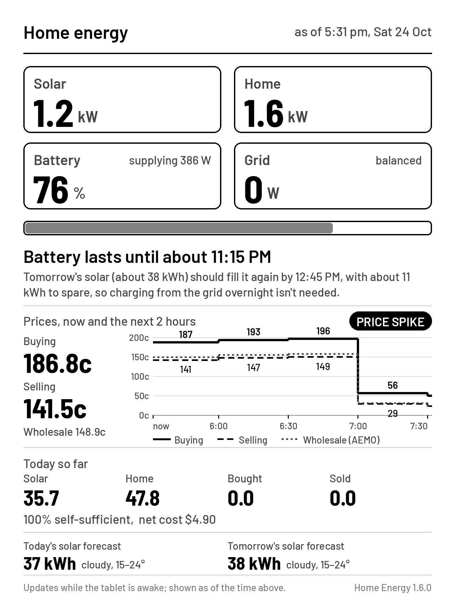

It updates while the tablet is awake (every 5 minutes, and when it wakes); a sleeping
reMarkable has Wi-Fi off, so the sleep screen shows the figures from when you put it down,
with that time printed at the top. Needs reMarkable software 3.20 or later.

1. On the tablet, open **Settings → Help → Copyrights and licenses** and note the root
   password at the bottom.
2. Plug the tablet into a computer with its USB-C cable, keep it awake and unlocked, and run
   `ssh root@10.11.99.1`, entering that password. (Recent reMarkable software turns SSH over
   Wi-Fi off, so `ssh root@<tablet's Wi-Fi IP>` is refused; the USB connection always works.
   The tablet still needs to be on the same Wi-Fi as the collector. To use SSH over Wi-Fi
   from then on, run `rm-ssh-over-wlan on` once over USB.)
3. Run this, using the address you open the dashboard at (for example `192.168.1.50:8088`):
   ```sh
   wget -qO- http://<collector address>/remarkable/install.sh | sh
   ```
4. Put the tablet to sleep.

**Heading and owner details.** The image keeps reMarkable's usual heading ("Paper tablet is
sleeping") at the top. The tablet still adds the owner name and phone number from its own
settings, centred near the bottom, on top of the image, so the layout leaves that strip clear.
To change the heading, put `SLEEP_TITLE="..."` in front of `sh` (it's remembered for
re-runs). The reMarkable logo isn't included, as it's reMarkable's trademark. On the image
itself: `/eink.png?rm=1&title=...` (`rm=1` keeps the owner strip clear).

**Away from home.** The collector is only on your home network, so elsewhere the tablet
can't refresh. It keeps the last figures for a while, then, after 3 hours without reaching the
collector, switches to an "Away from home" screen so old figures never look current; back on
your home Wi-Fi, the next refresh brings the live figures back. Change the delay with
`AWAY_HOURS=6` in front of `sh` when installing. Only a real image is ever used, so a hotel
or cafe Wi-Fi login page (or another device at the same address) can't replace the sleep
screen.

**To remove it completely:** `ssh` in again (over USB) and run `sh /home/root/home-energy/uninstall.sh`.
That stops the refresh, deletes the files and puts the normal sleep screen back. After a
reMarkable software update the sleep screen setting stays but the refresh stops, so run the
install command again (or the uninstaller).

## System health and alarms

The System panel shows the inverter's status, operating mode, grid, temperatures and
firmware, and decodes the alarm registers in Sigenergy's Modbus protocol into plain
messages. New alarms, and alarms clearing, go into the event log.

It also watches the **insulation resistance** of the solar wiring to earth, which Sigenergy
uses to detect damaged cables or water in a connector. Healthy systems usually read about
0.5 to 0.8 MΩ, and the inverter protects itself (stopping solar) below about 0.37 MΩ:

| Reading | Shown as |
|---|---|
| 0.5 MΩ or more | normal |
| below 0.5 MΩ | amber "lower than usual" notice and an event |
| below 0.37 MΩ | red alarm and an event |

It takes three readings in a row to change level, so one damp-morning reading doesn't set it
off. Change the limits with `INSULATION_WARN_MOHM` and `INSULATION_MIN_MOHM`. A reading that
stays low is worth having your installer check.

**Solar strings** are checked too. Each string's normal share of the solar is learned for every
hour of the day from three weeks of readings, so a string that's always shaded part of the day
isn't flagged for it. The **Vs usual** column in Solar > Strings compares the last few
days, sunny hours only, with that. Two days in a row under 85% of usual raises an amber notice; a
day under 40%, or a string making next to nothing for 20 minutes while the others produce, raises
a red alarm. New shade, dirt, a failed panel or optimiser, or a tripped isolator show up this way.
It starts after a week of string readings.

### Always-on use (History > Always-on)

Each night the home's use (without the car) between midnight and 5 am is sorted and its
quietest tenth taken: the level the house doesn't drop below, made up of the fridge and
freezer, network gear, standby power and anything left on. The panel shows the last week's
level, the change from four weeks earlier, what a year of it adds up to and costs at your
average buy price, and each night over the last 90 days. Every 10 W is about 88 kWh a year.

### When the collector was off

The SigenStor keeps no history that Modbus can read, but its lifetime counters keep counting while
the collector is away (the container restarted, the NAS was off, the network dropped). So when
readings resume after more than 5 minutes, the collector fills in the gap: the energy each way
(solar, home use, bought, sold, charged, discharged) is exact, and so is how much of it came after
midnight (from today's counters), so daily and monthly totals, money and payback stay right. How it
was spread over the minutes is estimated (solar by the weather model, home use by your usual use
for each hour), and the charts shade those stretches as **estimated**. Solar limits, solar vs
weather, battery trading and always-on use leave estimated minutes out. Car charging sessions
during the gap aren't recorded. System > Recent events says what was filled in. Gaps of more than
31 days, or where a counter went backwards (an inverter reset or swapped), are left as they are.

### Backups

Each night (`BACKUP_TIME`, default 2:30 am) the database is copied while the collector keeps
running, checked, and gzipped into the data folder's `backups` folder as
`sigen-YYYY-MM-DD.db.gz`. The last 7 days and one a week for 4 weeks before that are kept
(`BACKUP_KEEP_DAILY`, `BACKUP_KEEP_WEEKLY`). The System panel shows the last backup, with **Back up
now** from your home network (worth doing before an upgrade). Turn off with `BACKUPS_ENABLED=0`.

To restore: stop the container, unzip a backup and put it in the data folder as `sigen.db`
(delete `sigen.db-wal` and `sigen.db-shm` if they're there), and start the container.

### Phone alerts

Alarms, a stopped string or a failed backup are only seen when the dashboard is open, so the
collector can send them to your phone through [ntfy](https://ntfy.sh): free, no account, with an
app for iPhone and Android. They arrive as ordinary app notifications, not text messages, so the
SMS sender rules don't apply.

1. Install the ntfy app on your phone.
2. On the Settings page, under **Phone alerts**, press **Generate** next to Alerts topic, then
   **Save and restart**.
3. Press **Show** to see the topic name. In the ntfy app tap **+**, enter that name (server
   `ntfy.sh`) and subscribe.
4. Press **Send a test**.

The topic name works like a password: anyone who knows it can read the alerts, so the generated
one is long and random, and messages only say what's wrong with the system (no address,
location or links to your dashboard).

What's sent (choose with **Alert me about**, `NOTIFY_ON`): new alarms; a solar string down or
low; insulation faults; the inverter not answering for 10 minutes; a backup failing or the disk
filling up; prices, AEMO or weather failing for an hour; and a storm forecast while the battery
is expected to be under half full. Each problem is sent once when it starts and once, quietly,
when it clears, and a restart doesn't send them again. **Quiet hours** (`NOTIFY_QUIET`, like
`22:00-07:00`) make warnings arrive without a sound; faults still make one. **Weekly summary**
(`NOTIFY_WEEKLY`, like `sun 18:00`) sends the week's solar, use, cost and price spikes. Data
feeds in the System panel shows whether the last alert got through.

Running your own ntfy server? Set `NTFY_SERVER`, and `NTFY_TOKEN` if it needs one.

If the collector itself stops it can't send anything; Container Station's restart policy (or
an uptime monitor pointed at `/api/health`) covers that.

### Home Assistant (MQTT)

Set `MQTT_HOST` to your MQTT broker (for example Home Assistant's Mosquitto add-on), with
`MQTT_USERNAME` and `MQTT_PASSWORD` if it needs them. Every `MQTT_INTERVAL` seconds (default 10)
the live figures go to `sigen-dashboard/state` as one JSON message, and with discovery on
(`MQTT_DISCOVERY_PREFIX`, default `homeassistant`) Home Assistant creates a **Home Energy** device
with a sensor for each: power flows, battery charge, health and temperature, today's energy,
prices, and lifetime energy totals that suit Home Assistant's Energy dashboard. The sensors show as
unavailable when the collector stops. The System panel shows whether it's connected.

## Settings

Change these on the dashboard's **Settings** page, or set them as environment variables or in
`sigen.env` in the data folder (read on every start; restart the container after editing it by
hand). Values in `sigen.env` win over the container's environment.

| Setting | What it does | Default |
|---|---|---|
| **Inverter** | | |
| `SIGEN_HOST` | Inverter's IP address | required, unless simulating |
| `SIGEN_PORT` | Modbus TCP port | `502` |
| `SIGEN_PLANT_UNIT` / `SIGEN_INVERTER_UNIT` | Modbus unit ids (inverter `0` skips battery cell and string detail) | `247` / `1` |
| `SIGEN_CHARGER_UNIT` | AC charger: `auto` searches, a number reads that unit, `plant` uses the inverter's figures, `0` none | `auto` |
| `POLL_SECONDS` | How often to read the inverter (2 s minimum) | `5` |
| `SIGEN_SIMULATE` | `1` runs the built-in simulator instead | `0` |
| **Prices** | | |
| `AMBER_API_KEY`, `AMBER_SITE_ID` | Amber Electric | off |
| `LOCALVOLTS_API_KEY`, `LOCALVOLTS_PARTNER_ID`, `LOCALVOLTS_NMI` | LocalVolts | off |
| `PRICE_PROVIDER` | `amber`, `localvolts` or `none` if both are set | whichever has a key |
| `AEMO_REGION`, `AEMO_ENABLED` | AEMO region (`NSW1`, `QLD1`, `VIC1`, `SA1`, `TAS1`), or `0` to turn off | `NSW1`, on |
| **Weather and solar forecast** | | |
| `SITE_LAT`, `SITE_LON` | Where the panels are | off |
| `SITE_ADDRESS` | Or an address or suburb to look up once | off |
| `SOLAR_KWP` | Array size in kW, for a first estimate | none |
| `SOLAR_PLANES` | Roof faces as `tilt:azimuth:kW`, comma separated | one north face at 20° |
| `WEATHER_ENABLED` | `0` to turn weather off | on |
| **Checks** | | |
| `COMPARE_PLANS` | Compare with the Default Market Offer for your network: `nsw-ausgrid`, `nsw-endeavour`, `nsw-essential` (or put `plans.json` in the data folder) | off |
| `RETAILER_SUPPLY_C_DAY` / `RETAILER_FEE_MONTHLY` | Your own retailer's daily supply charge (c/day incl. GST) and monthly fee ($), from your bill. If the supply charge has changed, give each rate from its date: `2026-05-10:108.96,2026-07-01:119.6` | not included |
| `RETAILER_SINCE` | The day you started with your current retailer (`2026-05-10`); earlier days count towards payback (priced on the comparison plan, an estimate) but not the comparison | not set |
| `SYSTEM_COST` / `SYSTEM_INSTALLED` | What the solar and battery cost ($) and the date it was switched on, for payback | off |
| `INSULATION_WARN_MOHM` / `INSULATION_MIN_MOHM` | Insulation resistance warning and alarm levels, MΩ | `0.5` / `0.37` |
| `EXPORT_LIMIT_KW` | Your export limit, for Solar limits | learned |
| **Battery** | | |
| `BATTERY_WARRANTY_YEARS` / `BATTERY_WARRANTY_MWH` / `BATTERY_WARRANTY_SOH` | Warranty length, energy limit and warranted health (%), from your warranty | `10` / none / none |
| `BATTERY_RATED_CYCLES` | The datasheet's cycle life, for Battery > Health; blank to hide | `10000` |
| **Appliances** | | |
| `APPLIANCES` | Appliances to time, as `name:kW:hours`, comma separated (blank for none) | dishwasher, washing machine, dryer |
| **Backups** | | |
| `BACKUPS_ENABLED` | `0` turns nightly backups off | on |
| `BACKUP_TIME` | When to back up, 24-hour | `02:30` |
| `BACKUP_KEEP_DAILY` / `BACKUP_KEEP_WEEKLY` | Daily copies to keep, then weekly ones | `7` / `4` |
| `BACKUP_DIR` | Where backups go, inside the container | `backups` in the data folder |
| **Dashboard** | | |
| `GRID_VIEW` | How The grid shows all regions: `tiles`, `map` (nodes and wires) or `chain` | `tiles` |
| `TIME_FORMAT` | `12h` (6:30 pm) or `24h` (18:30), for every time on the dashboard | `12h` |
| `GOOD_TIME_SCALE` | The good-time indicator's scale: `adaptive` (from your own prices) or `fixed` | `adaptive` |
| `GOOD_TIME_FIXED` | For the fixed scale: green under the first price, dear from the second (c/kWh) | `15,35` |
| `GOOD_TIME_GREEN` | `cost` (cheap is green) or `renewables` (cheap and renewable enough) | `cost` |
| `GOOD_TIME_RENEWABLES` | Renewable share green needs, with `renewables` | `50` |
| `UPDATE_CHECK` | `off` stops the twice-daily check of GitHub releases for a newer collector | `on` |
| **Home Assistant (MQTT)** | | |
| **Targets** | | |
| `TARGET_SELF_SUFFICIENCY` | Self-sufficiency to aim for each month, %, or `12-2:90,3-11:70` | none |
| `TARGET_NET_MONTHLY` | Most Net cost each month, $ (negative = a credit), or month ranges | none |
| **Phone alerts** | | |
| `NTFY_TOPIC` | ntfy topic to send alerts to; blank = off | off |
| `NOTIFY_ON` | `all`, or any of `alarms,strings,insulation,inverter,backups,feeds,storm` | `all` |
| `NOTIFY_WEEKLY` | Weekly summary, like `sun 18:00`, or `off` | `off` |
| `NOTIFY_QUIET` | Warnings without a sound between these times, like `22:00-07:00` | none |
| `NTFY_SERVER`, `NTFY_TOKEN` | Your own ntfy server and its access token | `https://ntfy.sh`, none |
| `MQTT_HOST`, `MQTT_PORT` | Your MQTT broker; blank = off | off, `1883` |
| `MQTT_USERNAME`, `MQTT_PASSWORD` | If the broker needs them | none |
| `MQTT_TOPIC` | Where the figures go (`<topic>/state`) | `sigen-dashboard` |
| `MQTT_DISCOVERY_PREFIX` | Home Assistant discovery prefix; blank to skip discovery | `homeassistant` |
| `MQTT_INTERVAL` | Seconds between messages | `10` |
| **Collector** | | |
| `HTTP_PORT` | Dashboard and API port | `8080` |
| `DATA_DIR` | Where the database and `sigen.env` live | `/data` in Docker |
| `TZ` | Time zone for "today" | `Australia/Sydney` |
| `RETENTION_DAYS` | Days of minute history to keep | `800` |
| `SETTINGS_EDIT_FROM` | Who may change settings from the dashboard: blank = devices on the collector's own network; or addresses and ranges, comma separated (`192.168.1.0/24`); or `none` for read-only everywhere | the collector's network |

Simulator only: `SIM_PV_KWP`, `SIM_BATTERY_KWH`, `SIM_INVERTER_KW`, `SIM_EXPORT_LIMIT_KW`,
`SIM_PV_STRINGS`, `SIM_EV_CHARGER`, `SIM_CHARGER_MODBUS`, `SIM_INSULATION_MOHM`, `SIM_ALARMS`,
`SIM_STRING_FAULT` (`3:0.6:2` = PV3 at 60% for the last 2 days), `SIM_STORM` (`14-17` =
thunderstorms forecast tomorrow 2 to 5 pm), `DEMO_HISTORY_DAYS`.

## API

| Endpoint | What it returns |
|---|---|
| `GET /api/live` | Latest snapshot: power, battery, today, system, alarms, events, price |
| `GET /api/stream` | Same as live, pushed as Server-Sent Events on every poll |
| `GET /api/history?hours=24` | Bucketed power and SoC series (up to 31 days) |
| `GET /api/daily?days=30` | Daily kWh totals and net cost |
| `GET /api/prices?hours=12` | Retailer (Amber or LocalVolts): current prices, 24 h forecast, recent history |
| `GET /api/aemo?hours=24` | AEMO wholesale price, forecast, demand, generation mix, interconnectors, every region (`regions`) and whole-market totals (`nem`) |
| `GET /api/strings?hours=48&format=csv` | Per-minute voltage and current of each PV string (CSV download or JSON) |
| `GET /api/ev?days=30` | AC charger: live state, charging sessions and the last two days of state changes |
| `GET /api/ev-sessions?days=30&format=csv` | Charging sessions (CSV download or JSON) |
| `GET /api/ev-log?days=30&format=csv` | Every charger state change with power and offered current (CSV or JSON) |
| `GET /api/monthly?months=13&format=csv` | Monthly totals, costs and value (JSON or CSV) |
| `GET /api/trends?days=365` | Daily string energy, insulation, battery health, temperatures and solar vs weather (`pv_index`) |
| `GET /api/money` | Plan comparison by month and for the last 12 months, payback, battery trades with the grid |
| `GET /api/outlook` | Battery outlook: projected charge to the end of tomorrow, milestones and advice |
| `GET /api/weather` | Current weather, hourly and daily forecast, and the solar forecast in kWh |
| `GET /api/settings` | Every setting, its value and where it came from (keys and private values hidden away from home) |
| `POST /api/settings` | `{"changes": {"KEY": "value"}}` from the Settings page: checks, saves to `sigen.env` and restarts; home network only |
| `GET /api/strings-health` | Each solar string against its usual output over the last three days |
| `GET /api/limits?days=30` | Solar held back each day by reason (export limit, negative price, inverter, battery full), with the learned limits |
| `GET /api/battery-wear` | Cycles, throughput, round trip, health trend and warranty projection |
| `GET /api/baseload?days=90` | Always-on use: each night's baseline, now and four weeks ago, and a year's kWh and cost |
| `GET /api/appliances` | Best start time and cost for each appliance in `APPLIANCES` |
| `GET /api/trading?days=30` | Battery trading: spikes caught and missed, export prices, reserve what-if |
| `GET /api/ev-plan?kwh=20&by=07:00` | Car charging plan: the cheapest times to charge that many kWh before then |
| `GET /api/ui` | Display settings for the pages (time format) and a newer release, if there is one |
| `GET /api/bills` | Each bill beside what the data had for its period, and the difference |
| `POST /api/bills` | `{"action": "save", "bill": {...}, "replace": {start, end}}` or `{"action": "delete", "start", "end"}`; home network only |
| `POST /api/import` | `{"name": "file.csv", "data": "<base64>"}`: imports an Amber usage report, mySigen export or bills CSV; home network only |
| `GET /api/goodtime` | Is now a good time to use power: level, cost of an extra kWh, until when, the next good time, any spike, and best times for appliances |
| `GET /api/whatif?add_kwh=8&add_kw=3` | A year on each plan with your system, without the battery, with more battery and with more panels |
| `GET /api/targets` | This month against the targets (so far, projected, on track) and past months made or missed |
| `GET /api/notify` | Phone alerts: on or off, what's watched, the last one sent and any problems still open |
| `POST /api/notify` | `{"action": "test"}` sends a test alert; home network only |
| `GET /api/maintenance` | Database size, history span, free disk, recent imports and the version check |
| `POST /api/maintenance` | `{"action": "vacuum"}` compacts the database; `{"action": "check-update"}` checks now; home network only |
| `GET /api/backups` | Backup status and the backups kept; `POST` (home network only) backs up now |
| `GET /api/health` | `{ok, status, updated, version}` for monitoring |
| `GET /api/debug` | Raw register values, unsupported registers and the charger search, for troubleshooting |

Signs: `grid` positive = buying, negative = selling. `battery` positive = charging.

## Troubleshooting

* **"Inverter not responding"**: check Modbus TCP is enabled and saved, the IP is right,
  and nothing else is holding the inverter's Modbus connection (some systems only allow
  one client; Home Assistant's Sigenergy integration counts).
* **Plant values fine but no battery cell / PV string detail**: wrong inverter unit id,
  see `SIGEN_INVERTER_UNIT`.
* `exception code 2` in logs means a register your firmware doesn't expose; it's
  skipped automatically.
* **Diagnostics:** `http://<collector>:8080/api/debug` (8088 on a QNAP) shows the raw values
  read from the inverter, including alarm registers in hex and any registers your firmware
  doesn't support. Alarm registers with bits set that Sigenergy's protocol doesn't define
  are treated as unsupported filler values and ignored (they're listed in the log).
* **AC charger not found**: the `charger` section of `/api/debug` lists which unit ids
  answered during the search. If your installer knows the charger's id, set
  `SIGEN_CHARGER_UNIT` to it. If the charger has no Modbus address, set
  `SIGEN_CHARGER_UNIT=plant` to show charging from the inverter's figures instead.
* **No weather panel**: set `SITE_LAT` and `SITE_LON` (or `SITE_ADDRESS`); problems show in
  the collector log on lines starting `Weather:`.
* **Solar forecast way off**: it calibrates over a few sunny days; set `SOLAR_KWP` and
  `SOLAR_PLANES` for a better start.
* **Which version am I running?** It's at the bottom of the dashboard, and in `/api/health`.
* **Widget says "Can't reach collector"**: click its status text to open the dashboard and
  fix the address. The collector must be reachable from that computer on port 8080.

## Development

Standard library only. Tests:

```
python -m unittest discover -s tests     # unit tests
python tests/smoke.py                    # starts the collector on the simulator and checks every endpoint
```

Both run on every push (GitHub Actions, **Tests**). See [ROADMAP.md](ROADMAP.md) for what's planned.

## Licence

MIT, see [LICENSE](LICENSE).

## Credits

Built with [Claude](https://claude.ai) by Anthropic, which designed and wrote the code
with copperOstrich.

Register map from Sigenergy's Modbus Protocol (V2.7–V2.9) as implemented by the
[Sigenergy Local Modbus](https://github.com/TypQxQ/Sigenergy-Local-Modbus) Home Assistant
integration; Amber endpoints from Amber's public API spec; LocalVolts fields as used by the
[Localvolts Home Assistant integration](https://github.com/gurrier/localvolts); AEMO feeds
as used by [aemonemdata](https://github.com/cabberley/aemonemdata) and AEMO's NEM data dashboard.
Weather and irradiance forecasts by [Open-Meteo](https://open-meteo.com) (CC BY 4.0); address lookup by
[OpenStreetMap Nominatim](https://nominatim.org).
