# Home Energy: SigenStor dashboard

[](https://github.com/copperOstrich/sigen-dashboard/releases/latest)
[](https://github.com/copperOstrich/sigen-dashboard/pkgs/container/sigen-dashboard)
[](https://github.com/copperOstrich/sigen-dashboard/actions/workflows/docker.yml)
[](LICENSE)

A local dashboard for a SigenStor system that reads the inverter
directly over **Modbus TCP**, so it keeps working when Sigenergy's cloud is down.
Live retailer prices from **Amber Electric** or **LocalVolts** add buy/sell prices, spike
warnings, forecasts and what your power is costing, and free **AEMO** market data shows
the wholesale price, demand and generation mix for your region. Free **Open-Meteo** weather
gives a local forecast and a **solar production forecast** that learns from your own panels.
If you have a **Sigen AC charger**, it shows the car charging too, with a log of every session.

<picture>
  <source media="(prefers-color-scheme: dark)" srcset="docs/screenshots/power-flow-dark.png">
  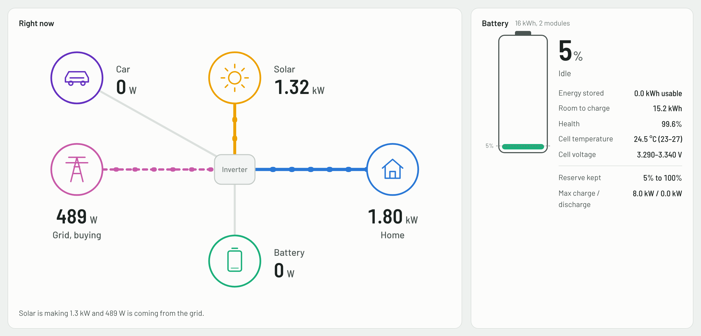
</picture>

```
                                          ┌── Amber or LocalVolts API (optional)
SigenStor ──Modbus TCP (read-only)──▶ Collector (Docker / Pi / NAS) ◀── AEMO market data
  (inverter, battery, AC charger)        │  SQLite history,      ◀── Open-Meteo weather (optional)
                                         │  web dashboard, JSON API
                     ┌───────────────────┼─────────────────────┐
              Browser dashboard    Installed as an app   Phone / tablet browser
```

* **Collector** (`collector/`): Python standard library only, no packages to install.
  Polls every 5 s, keeps minute history for ~2 years, serves the dashboard on port 8080.
* **Dashboard** (`web/`), in panels you can show, hide, reorder and resize:
  * live power flow between solar, battery, home, grid and car, with battery detail
  * today's totals, self-sufficiency and cost
  * battery outlook: will it last the night, when it fills again, and whether grid charging is worthwhile
  * weather, four-day forecast and a solar forecast in kWh
  * car charging from a Sigen AC charger: state, sessions, energy and cost
  * retailer and wholesale prices with forecasts, and the grid's generation mix
  * power and battery history, with a Today view
  * solar strings, sunrise to sunset, for spotting shading or a faulty string
  * daily energy and cost for the last 30 days, a monthly summary with a printable report,
    and trends over months (string output, insulation, battery health, temperatures)
  * system status, decoded alarms, insulation resistance check and an event log

  Light and dark mode, works on a phone, and shows the version you're running at the bottom.
* **Compact widget** (`/widget.html`): solar, home, battery and grid in a small window.
  The dashboard and the widget can each be installed as an app from Edge or Chrome, or added
  to a phone's home screen: see [On your computer or phone](#5-on-your-computer-or-phone).

It never writes to the inverter. The Modbus client has no write functions, so it can't
interfere with retailer battery control such as Amber SmartShift or a VPP.

## Quick start

You need a machine on your home network that stays on (a NAS, Raspberry Pi or mini PC)
with Docker installed.

```sh
mkdir sigen-dashboard && cd sigen-dashboard
docker run -d --name sigen-dashboard --restart unless-stopped \
  -p 8080:8080 -v "$PWD/data:/data" \
  -e SIGEN_SIMULATE=1 -e AEMO_REGION=NSW1 \
  ghcr.io/copperostrich/sigen-dashboard:latest
```

Open `http://<that-machine>:8080`. It starts on simulated data so you can look around.
Then point it at your inverter and add your retailer, either with `-e` settings or in a
`data/sigen.env` file (copy [`qnap/sigen.env.example`](qnap/sigen.env.example)):

```sh
SIGEN_SIMULATE=0
SIGEN_HOST=192.168.1.60      # your inverter's IP address (Modbus TCP must be enabled)
AMBER_API_KEY=...            # or LOCALVOLTS_API_KEY and LOCALVOLTS_PARTNER_ID
SITE_LAT=-33.87              # optional: for weather and the solar forecast
SITE_LON=151.21
SOLAR_KWP=10                 # optional: your array size in kW
```

Every setting is listed under [Settings](#settings).

Change settings later from the dashboard's **Settings** page (the gear, top right), or edit
`sigen.env` and restart the container. To have it as an app on your computer or
phone, see [On your computer or phone](#5-on-your-computer-or-phone).
On a QNAP, see [the ready-made setup](#ready-made-image-qnap-synology-unraid-portainer).

## Keep it on your home network

The dashboard has no login, and anyone who can reach it can see your energy data. Don't
forward its port on your router or expose it to the internet. To check in when you're
away, use a VPN to your home network (Tailscale, WireGuard, or your router's built-in VPN).
The collector only ever reads from the inverter, so the dashboard can't change any
settings, but your usage pattern is still personal information.

## Screenshots

Screenshots switch between light and dark to match your GitHub theme; both versions are in
[`docs/screenshots`](docs/screenshots). They were taken with the built-in simulator, so the
numbers are realistic but not from a real home.

**Live prices and the grid**: your retailer's buy and sell price with a 24-hour forecast,
AEMO's wholesale price, your region's generation mix, and every NEM region side by side.

<picture>
  <source media="(prefers-color-scheme: dark)" srcset="docs/screenshots/prices-grid-dark.png">
  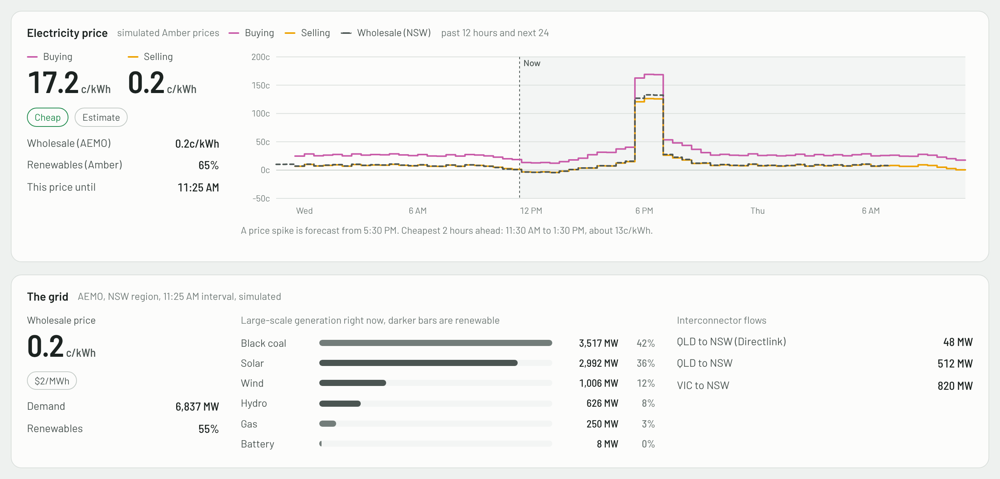
</picture>

**Money**: whether your retailer is worth it against the Default Market Offer (or your own
quotes), priced on your own usage hour by hour; how far the solar and battery are towards paying for
themselves; and every time the battery traded with the grid (for example Amber SmartShift),
with what it earned.

<picture>
  <source media="(prefers-color-scheme: dark)" srcset="docs/screenshots/money-dark.png">
  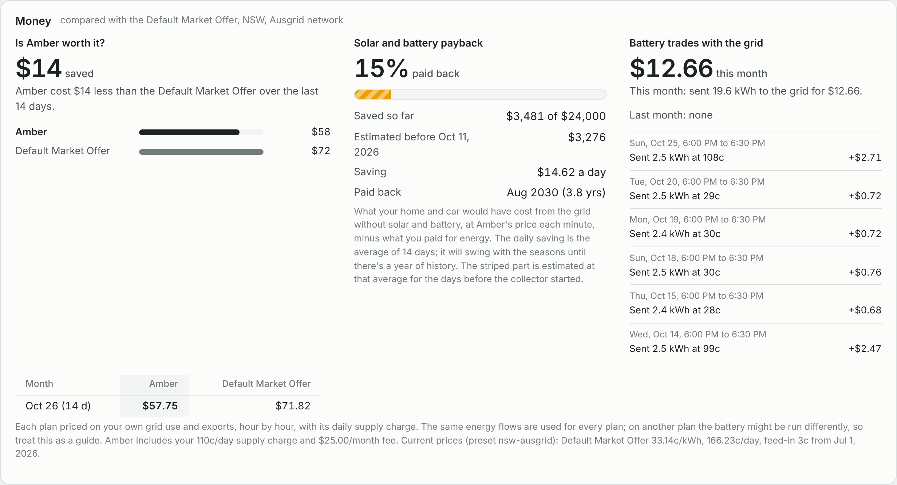
</picture>

**Battery outlook**: where the battery's charge is heading until the end of tomorrow, with
plain answers: will it last the night, what the grid will cost until sunrise, when solar fills
it again, and whether charging from the grid overnight is worth it.

<picture>
  <source media="(prefers-color-scheme: dark)" srcset="docs/screenshots/outlook-dark.png">
  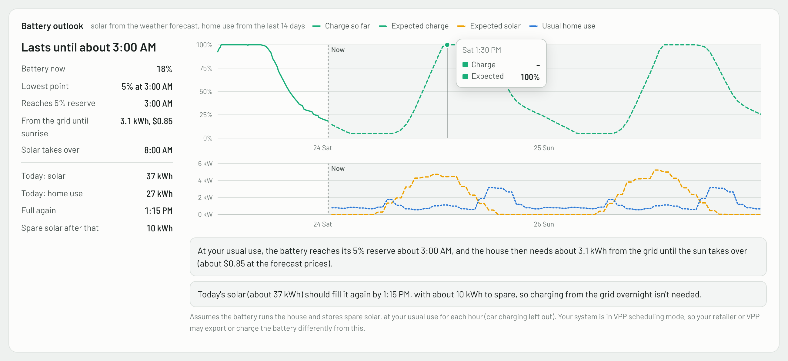
</picture>

**Weather and solar forecast**: current conditions, four days ahead, and a solar forecast
in kWh, with today's forecast hour by hour against what the panels actually made.

<picture>
  <source media="(prefers-color-scheme: dark)" srcset="docs/screenshots/weather-dark.png">
  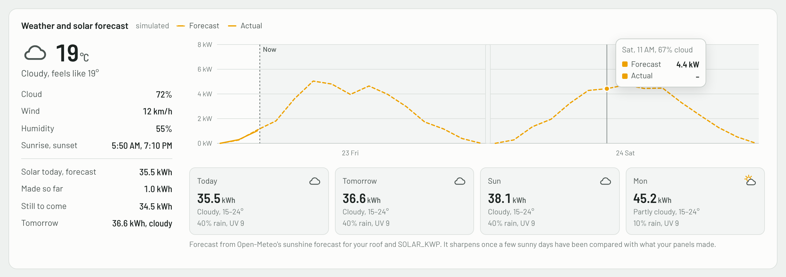
</picture>

**History**: power flows and battery charge from today to 30 days, with a crosshair to
read any moment.

<picture>
  <source media="(prefers-color-scheme: dark)" srcset="docs/screenshots/history-dark.png">
  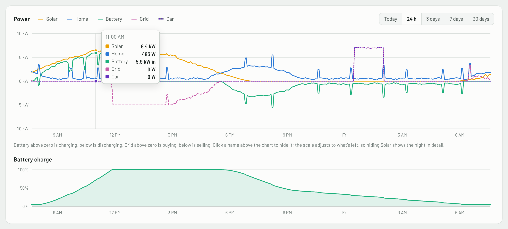
</picture>

**Solar strings**: power, voltage and current for each PV string your inverter reports,
sunrise to sunset with the nights folded away, plus each string's energy, share and peak
for the day. Handy for spotting shading or a faulty panel, and for telling which roof face is
on which string.

<picture>
  <source media="(prefers-color-scheme: dark)" srcset="docs/screenshots/strings-dark.png">
  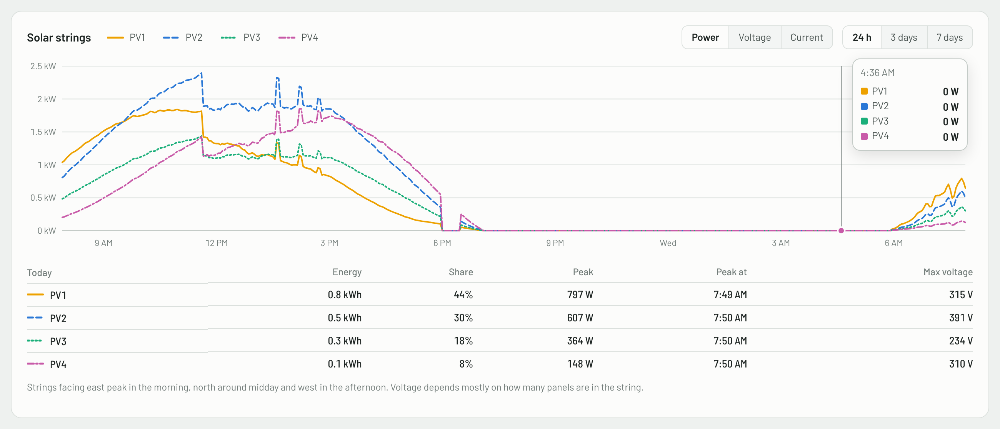
</picture>

**Car charging** (with a Sigen AC charger): the charger's state, this session's energy
and cost, a 48-hour timeline and recent sessions.

<picture>
  <source media="(prefers-color-scheme: dark)" srcset="docs/screenshots/ev-charging-dark.png">
  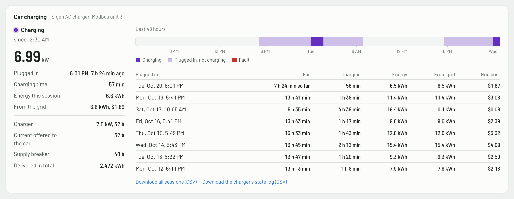
</picture>

**Daily energy and system status**: each day's energy in (solar, bought, from battery) and
out (home, sold, to battery), plus inverter status and alarms.

<picture>
  <source media="(prefers-color-scheme: dark)" srcset="docs/screenshots/daily-system-dark.png">
  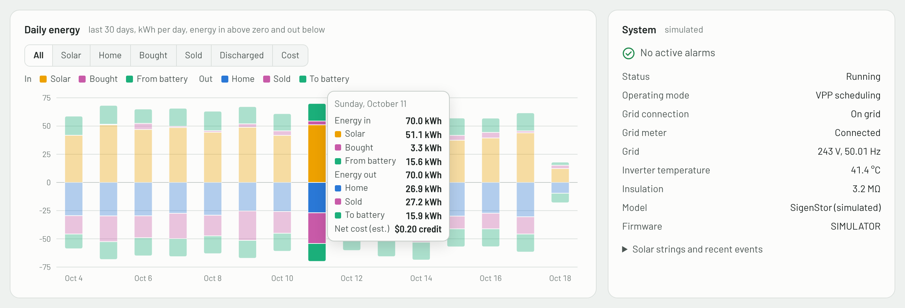
</picture>

**Monthly summary**: each month's solar, use, bought and sold, self-sufficiency, cost and the
value of your solar and battery, against the same month last year, plus a printable report.

<picture>
  <source media="(prefers-color-scheme: dark)" srcset="docs/screenshots/monthly-dark.png">
  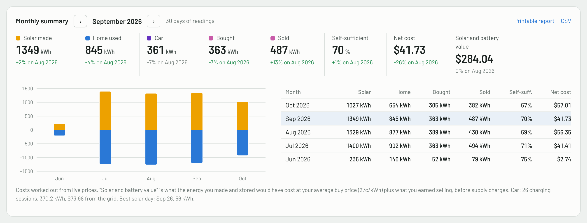
</picture>

**Trends**: slow changes over months that a daily view hides. Here, insulation resistance
each day against the warning and alarm levels; it can also show each string's share of the
solar, battery health and temperatures.

<picture>
  <source media="(prefers-color-scheme: dark)" srcset="docs/screenshots/trends-dark.png">
  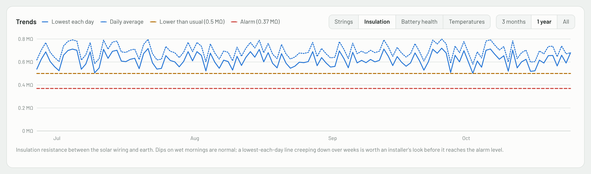
</picture>

**Arrange panels**: hide what you don't use, and change the order and width of the rest.

**Settings** (the gear): every setting below, grouped, with what each one does. Saving writes
`sigen.env` in the data folder (the previous file is kept as `sigen.env.bak`, and your comments
stay) and restarts the collector, which takes a few seconds. Settings can only be changed from
a device on the collector's own network: from anywhere else the gear is greyed out, the page
is read-only, and API keys, addresses and your location are never sent. Keys are shown masked
at home too, with **Show** to reveal one. If the dashboard sits behind a reverse proxy, every
visitor looks local, so set `SETTINGS_EDIT_FROM` to the addresses allowed to make changes.

<picture>
  <source media="(prefers-color-scheme: dark)" srcset="docs/screenshots/arrange-dark.png">
  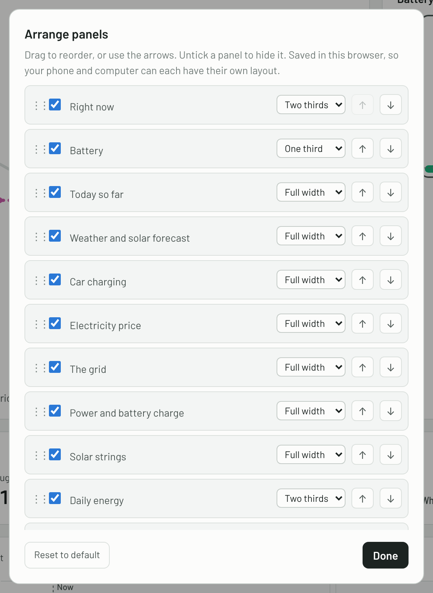
</picture>

**Compact widget and phone**: the small widget view (`/widget.html`), and the dashboard
on a phone.

<p>
<picture>
  <source media="(prefers-color-scheme: dark)" srcset="docs/screenshots/widget-dark.png">
  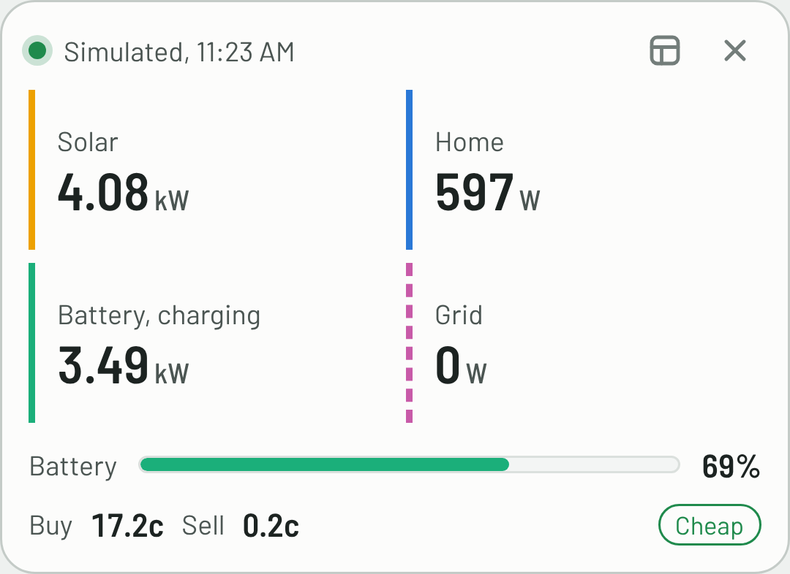
</picture>
&nbsp;
<picture>
  <source media="(prefers-color-scheme: dark)" srcset="docs/screenshots/phone-dark.png">
  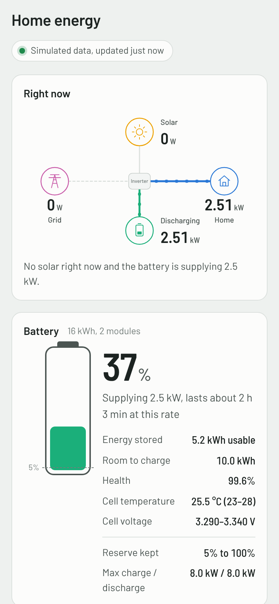
</picture>
</p>

<details>
<summary>The whole dashboard</summary>

<picture>
  <source media="(prefers-color-scheme: dark)" srcset="docs/screenshots/dashboard-dark.png">
  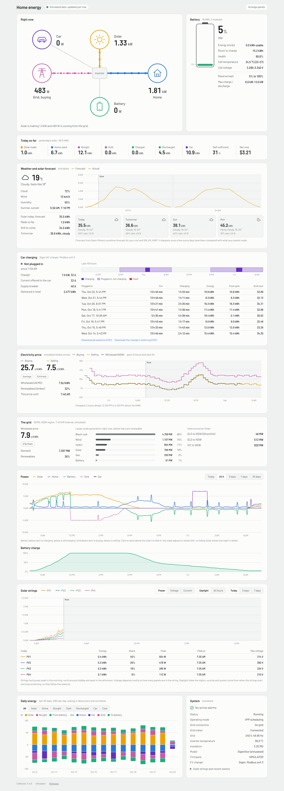
</picture>

</details>

## 1. Run the collector

On any always-on machine on your home network (NAS, Raspberry Pi, mini PC) with Docker:

```sh
cp .env.example .env        # edit it
docker compose up -d --build
```

Open `http://<that-machine>:8080`.

No Docker? Python 3.9+ is all it needs:

```sh
SIGEN_SIMULATE=1 python3 collector/sigen_collector.py          # simulated data
SIGEN_HOST=192.168.1.60 python3 collector/sigen_collector.py   # real system
```

### Ready-made image (QNAP, Synology, Unraid, Portainer)

GitHub builds an image for Intel/AMD and ARM: `ghcr.io/copperostrich/sigen-dashboard:latest`.
On a QNAP:
1. With File Station, save [`qnap/sigen.env.example`](qnap/sigen.env.example) as
   `/share/Container/sigen-dashboard/sigen.env` and fill it in.
2. Paste [`qnap/docker-compose.yml`](qnap/docker-compose.yml) into
   **Container Station → Applications → Create**.
3. Open `http://<NAS-IP>:8088`. It uses port 8088 because QTS's own admin page is on 8080.

To give the dashboard its **own address on your network** (so it's at
a plain address with no port, or a name you set up on your router's DNS), use
[`qnap/docker-compose.own-ip.yml`](qnap/docker-compose.own-ip.yml) instead; the comments at the
top say which three values to change.

History is kept in `/share/Container/sigen-dashboard`. To change a setting later, use the
dashboard's **Settings** page, or edit `sigen.env` and restart the container.

Any Docker host can do the same: every setting can go in a `sigen.env` file in the data
folder (mounted at `/data`), which is read on each start and overrides the container's
environment.

### Until Modbus TCP is available

Leave `SIGEN_SIMULATE=1`. A built-in simulator of an example home system (10 kWp solar,
16 kWh battery, 10 kW inverter, 5 kW export limit) serves the exact same Modbus
registers, so everything is exercised end to end. To make it resemble your own system,
set `SIM_PV_KWP`, `SIM_BATTERY_KWH`, `SIM_INVERTER_KW` and `SIM_EXPORT_LIMIT_KW`. It pre-fills 14 days of history and
the dashboard shows a "simulated data" banner. Simulated history is kept in a separate
database (`data/simulator.db`) and never mixes with real readings.

You can also run the simulator on its own as a fake inverter:
`python3 collector/simulator.py --port 5020`, then `SIGEN_HOST=127.0.0.1 SIGEN_PORT=5020`.
`SIM_ALARMS="alarm1:9"` sets alarm bits so you can see how alarms look.

### Switching to the real system

1. **Enable Modbus TCP server** on the SigenStor. This is in the mySigen app's
   communication settings and usually needs the **installer account**, so you may
   need to ask your installer. Make sure they tap Save.
2. Give the inverter a **fixed IP** (DHCP reservation in your router).
3. In `.env`: `SIGEN_SIMULATE=0`, `SIGEN_HOST=<inverter IP>`, then
   `docker compose up -d`.

Defaults match Sigenergy's protocol: port 502, plant unit **247** (whole-system values),
inverter unit **1** (battery cells, PV strings, temperatures). If you also have a
Sigen AC charger, the inverter is often unit 2; set `SIGEN_INVERTER_UNIT=2`.

### Sigen AC charger

A Sigen EVAC charger connected to the system is read through the same Modbus TCP
connection, at the charger's own unit id. That id isn't shown in the mySigen app, so the
collector looks for it: it checks one id per poll alongside the normal readings (about
20 minutes for all 246), then logs `Found an AC charger at Modbus unit N`. Put that number
in `SIGEN_CHARGER_UNIT` to skip the search next time, or set `SIGEN_CHARGER_UNIT=0` if you
don't have a charger. If none is found it looks again every 12 hours.

**If the charger has no Modbus address** (common: setting one needs the installer
account), the collector still shows the car's charging, worked out from the inverter's own
figures: its split of total load from household load, and its counter of energy sent to the
charger. That gives charging power, sessions, energy and cost. Set `SIGEN_CHARGER_UNIT=plant` to skip
the search and use this straight away. What it can't show is the
charger's own state (plugged in but not charging) or its alarms; for those, ask your
installer to give the charger a Modbus address.

Once found, the dashboard shows:

* the car in the power flow, and its charging on the power and daily energy charts
  (the home figures then leave the car out)
* the charger's state in plain words (not plugged in, plugged in and waiting, charging,
  plugged in but the car isn't drawing power, faults) and the current it's offering
* each session: when the car was plugged in, how long it actually charged, energy, how
  much came from the grid and what that cost at your retailer's price
* a 48-hour timeline of plug-ins and charging, and the charger's alarms in the event log

The sessions and every state change can be downloaded as CSV from the panel, or from
`/api/ev-sessions?format=csv` and `/api/ev-log?format=csv`. The states are the standard
IEC 61851 ones (A, B1, B2, C2, E, F), so the log is a precise record of what the charger
offered and what the car did, which is useful if a car won't charge. As with everything
else, the charger is only read, never controlled.

## 2. Add your retailer's prices (optional)

Pick one. The keys stay on the collector; browsers never see them.

**Amber Electric**

1. Sign in at app.amber.com.au, open **Developers**, generate a token.
2. Add `AMBER_API_KEY=...` to `.env` and restart.

**LocalVolts**

1. On localvolts.com open **My Profile → API Key** for your **API key** and **Partner ID**.
   If no key is shown, request one at localvolts.com/localvolts-api.
2. Add `LOCALVOLTS_API_KEY=...` and `LOCALVOLTS_PARTNER_ID=...` to `.env` and restart.
   Your NMI is found automatically; set `LOCALVOLTS_NMI` only if you have several.

With either one you get:

* the current buy and sell price, a cheap/expensive rating and spike status
* a chart of the past 12 hours and next 24, "cheapest 2 hours ahead" and spike forecasts
* a spike banner on the dashboard and the price on the widget
* **today's net cost**, worked out minute by minute from your actual grid flow × the
  price in force at the time
* **daily cost** history; once the retailer's meter data arrives it replaces the
  estimate (LocalVolts' figures include daily supply charges, Amber's don't)

Notes:
* Amber reports feed-in prices as negative when you're paid; the dashboard shows a
  positive "selling" price and counts it as credit.
* LocalVolts prices are the marginal cost of one more kWh (`costsFlexUp`) and what one more
  exported kWh earns (`earningsFlexUp`), including network charges and losses.
* If both are configured, LocalVolts is used; set `PRICE_PROVIDER=amber` or `localvolts`
  to choose. In simulator mode without a key, Amber-style prices are simulated.
* **Other retailers** (GloBird and most others) don't offer a public price API. You
  still get the AEMO wholesale price below, which is what dynamic tariffs follow.

### Money: plans, payback and battery trades

The **Money** panel needs retailer prices (above) and a little setup in `sigen.env`:

* **Is your retailer worth it?** Your own grid use and exports, hour by hour, priced on
  another plan (daily supply charge, usage rate flat or time of use, feed-in tariff) against
  what you actually paid, for each month and the last 12 months. Set `COMPARE_PLANS` to your
  network, `nsw-ausgrid`, `nsw-endeavour` or `nsw-essential`, to compare with the **Default
  Market Offer**: the price cap the Australian Energy Regulator sets each year for standing
  offers, which the big retailers' default plans sit at. It's official and changes once a year,
  so nothing depends on retailer websites. Prices are dated: each year's apply from its 1 July,
  so past months keep the prices in force then. To compare with a real quote too (market
  offers are usually cheaper than the DMO), copy a file from [`collector/plans/`](collector/plans)
  to `plans.json` in your data folder and add plans to it; time-of-use windows and your own
  feed-in rate work there. Set `RETAILER_SUPPLY_C_DAY` (and `RETAILER_FEE_MONTHLY` for a
  membership fee) from your own bill so your side includes them; without them the comparison
  is energy only. Every plan uses the same energy flows, so it's a guide: on a different plan
  the battery might be run differently.
* **Payback**: set `SYSTEM_COST` (dollars) and optionally `SYSTEM_INSTALLED` (`2025-03-15`).
  Shown two ways, side by side. **Against your retailer's prices**: what your home and car would
  have cost from the grid without solar and battery, at your retailer's price at the time, minus
  what you paid for energy (supply charges cancel out). **Against the comparison plan** (the
  Default Market Offer): the same use on a standard plan with its supply charge, minus everything
  you paid including supply and fee, since without a battery a wholesale-price retailer may not
  have suited you. The gap between them is what being with your retailer adds. With the car-against-fuel settings (below),
  each also gets a "+ fuel" column, where the car's charging is counted against the fuel a
  comparable car would have burnt: four paybacks in all. Days before the collector started are estimated at the average daily saving;
  the payback date is a projection from the last 12 months (or what's recorded so far).
* **Battery trades**: whenever the battery sends power to the grid, or charges from it, beyond
  what the house needs. Under normal self-consumption it does neither, so these are your
  retailer's battery control (Amber SmartShift) or VPP events. Each is shown with its energy,
  average price and value, with totals for this month and last. Needs no setup.

### History from before the collector (mySigen import)

The collector only knows what it has recorded itself. To bring in everything since your system
was switched on, export the daily figures from the mySigen app: the station's statistics,
**Energy**, **Day** view (one row per day; not Month, Year or Lifetime), export. You get a file
named like `stationData-...-Energy.xlsx`.

Copy it into the `import` folder inside the data folder (the collector creates it; on a QNAP,
`/share/Container/sigen-dashboard/import`) and restart the container. The log says what it
imported, and the file is renamed to `.imported`. Imported days fill the daily and monthly
history, the Money panel and payback, but never replace days the collector recorded itself.
With Amber, the collector also fetches Amber's daily costs back to the first imported day
(a few requests at a time), so those days have real dollars. Amber's service only reaches back
about 90 days; the log says how far it got. If you joined your retailer after the system was
switched on, set `RETAILER_SINCE`: the days before count towards payback, priced on the
comparison plan, and are left out of the comparison.

For older days than your retailer's service returns, use your bills: a CSV in the same
`import` folder, one row per bill (dollars incl. GST):

```
start,end,energy_cost,export_credit,avg_buy_c
2026-05-10,2026-05-31,18.94,30.48,19.35
```

`energy_cost` is the bill's usage and network demand charges (not the supply charge or fee),
`export_credit` what it credited for exports, and `avg_buy_c` (optional) its average usage rate.
Each bill is spread over its days that have no costs yet, in proportion to each day's grid use
and exports, after taking off any days already known, so monthly totals match the bills. A CSV with the same columns
works too. The 5-minute **Power** export isn't needed and is skipped.

### The car against a fuel car

With an AC charger (or charging worked out from the inverter's figures), each charging session
can be set against what a comparable petrol or diesel car would have spent on fuel for the same
distance, at the servo prices near you that day. The Car charging panel shows the saving per
session, this month and in total, and payback gets a third view, "+ fuel", where the car's
energy is counted against fuel instead of grid power.

| Setting | What it is |
|---|---|
| `EV_MODEL`, `EV_KWH_PER_100KM` | Your EV and its real-world energy use (kWh per 100 km) |
| `COMPARE_VEHICLE`, `COMPARE_L_PER_100KM` | The fuel car to compare with and its fuel use (L per 100 km) |
| `FUEL_TYPE` | `E10`, `U91`, `U95`, `U98` or `Diesel` (default `U91`) |
| `FUEL_RADIUS_KM` | Stations within this distance of home, from `SITE_LAT`/`SITE_LON` or `SITE_ADDRESS` (default 10) |
| `FUEL_EXCLUDE_BRANDS` | Brands to leave out, comma separated (default `Costco`, as members-only prices aren't what most people pay) |
| `FUELCHECK_API_KEY`, `FUELCHECK_API_SECRET` | NSW (and Tasmania): live prices from FuelCheck. Free: sign up at [api.nsw.gov.au](https://api.nsw.gov.au), create an app and subscribe it to the Fuel API |
| `FUELWATCH_SUBURB` | WA: live prices from FuelWatch, no account needed |
| `FUEL_PRICE_C_L` | A fixed price (c/L), used where there's no live source and for sessions before prices were first recorded |

The average price for your fuel type at the stations in range is recorded a few times a day, so
every session is priced at its own day. A session's charging cost is its grid energy at what you
paid, plus its solar energy at what that would have earned exported at the time (free when the
export price is negative). The sessions download includes all of it.

## 3. AEMO market data (on by default, no account needed)

Every 5 minutes the collector reads AEMO's public National Electricity Market feeds for
your region and shows:

* the wholesale price (5-minute actuals and AEMO's 30-minute forecast) as a dashed line
  on the price chart, and on the widget if you have no retailer prices
* demand, the large-scale generation mix (coal, gas, solar, wind, hydro, battery) and
  the renewable share
* interconnector flows to neighbouring regions, plus price-cap and market-suspension flags
* **all regions at a glance**: a map of NSW, Queensland, Victoria, South Australia and
  Tasmania with each one's wholesale price, demand, renewable share and whether it's
  importing or exporting, the flows between them, and whole-market demand, renewable share
  and average price (a table on phones). It comes from the same AEMO requests, so it costs
  nothing extra.

Set your region with `AEMO_REGION` (`NSW1`, `QLD1`, `VIC1`, `SA1` or `TAS1`; default
`NSW1`), or turn it off with `AEMO_ENABLED=0`. These feeds power AEMO's own NEM data
dashboard but aren't an officially supported API, so AEMO could change them; if that
happens only this panel stops, everything else carries on. Wholesale prices are shown in
c/kWh ($/MWh ÷ 10) and exclude network charges, so they're a guide to when power is
cheap rather than what you pay.

## 4. Weather and solar forecast (optional, no account needed)

Set where the panels are, then restart the collector:

```
SITE_LAT=-33.87        # right-click your roof in Google Maps to copy these
SITE_LON=151.21
# or instead:  SITE_ADDRESS=Bendigo VIC   (a suburb is plenty; looked up once and cached)
SOLAR_KWP=10           # array size, for a first estimate
SOLAR_PLANES=22:90:5,22:270:5   # optional: each roof face as tilt:azimuth:kW (0 north, 90 east, 270 west)
```

The dashboard then shows current weather, four days of forecast and a solar forecast in kWh,
with an hour-by-hour chart of forecast against actual production. Weather comes from
[Open-Meteo](https://open-meteo.com) (free for non-commercial use). The solar forecast starts
from the sunshine forecast for your roof faces and then calibrates itself against what your
panels actually made over the last two weeks, so after a few sunny days it reflects your own
system's losses, shading and clipping. If you give an address, it's sent once to
OpenStreetMap's Nominatim to find the coordinates; nothing else about your system leaves home.

For the best forecast, describe each roof face in `SOLAR_PLANES` as `tilt:azimuth:kW`,
comma separated: tilt is the roof pitch in degrees, azimuth is the compass direction the
panels face (0 north, 90 east, 180 south, 270 west) and kW is that face's panels. East and
west faces then get their morning and afternoon peaks at the right times. Without it, the
whole array is treated as one north-facing roof at 20°. The weather panel can be hidden with
**Arrange panels**, or turned off with `WEATHER_ENABLED=0`.

### Battery outlook

With a couple of days of history, the dashboard projects the battery's charge from now to the
end of tomorrow, in 15-minute steps:

* **home use**: your typical use for each hour over the last two weeks, weekdays and weekends
  separately, without car charging
* **solar**: the forecast above when it's set up, otherwise a typical recent day
* **battery**: runs the house and stores spare solar between your reserve and charge limit,
  at its maximum rates, allowing for charging losses

From that it tells you whether the battery lasts the night, how much the house needs from the
grid until solar takes over (and the cost at your retailer's forecast prices), when it's full
again and what's left over, and whether charging from the grid overnight is worth it. It's a
model of self-consumption, not of your retailer's control: with Amber SmartShift or another
VPP managing the battery, it may export or charge differently, and the panel says so.

## 5. On your computer or phone

There's nothing to install: open the dashboard's address in a browser. To give it its own
window, taskbar or dock icon and Start menu entry, install it as an app from the browser:

* **Edge (Windows):** open the dashboard, then **⋯ → Apps → Install this site as an app**.
* **Chrome (Windows, Mac):** **⋮ → Cast, save and share → Install page as app** (or
  **Create shortcut** with **Open as window** ticked).
* **iPhone, iPad:** in Safari, **Share → Add to Home Screen**.
* **Android:** in Chrome, **⋮ → Add to Home screen**.

The **compact widget** works the same way: open `http://<collector>/widget.html`, install it
as its own app and size the window to suit. It shows solar, home, battery and grid, the price
and the car, and opens the full dashboard from its button.

Earlier versions had a Windows desktop app. It's been withdrawn: without a paid code-signing
certificate, Windows Smart App Control (and macOS) block it, and the browser does the same job.
If you installed it, uninstall it from **Settings → Apps**.

## reMarkable 2 sleep screen (optional)

The collector draws an e-ink version of the dashboard at `http://<collector>/eink.png`:
the four flows, battery and its outlook, the buy, sell and wholesale prices for the next two
hours, today's totals and the solar forecast in large black-and-white type, sized for a reMarkable 2 (other sizes with `?w=1072&h=1448` and so on).
A reMarkable 2 can show it as its sleep screen, so the tablet becomes an energy display when
you put it down.

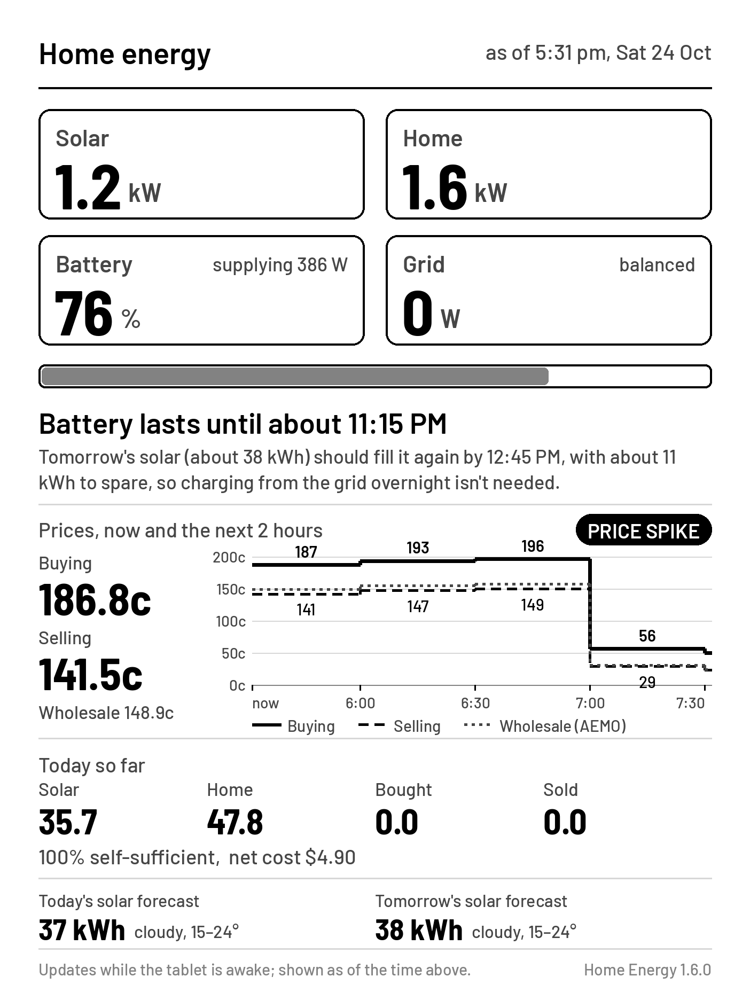

It updates while the tablet is awake (every 5 minutes, and when it wakes); a sleeping
reMarkable has Wi-Fi off, so the sleep screen shows the figures from when you put it down,
with that time printed at the top. Needs reMarkable software 3.20 or later.

1. On the tablet, open **Settings → Help → Copyrights and licenses** and note the root
   password at the bottom.
2. Plug the tablet into a computer with its USB-C cable, keep it awake and unlocked, and run
   `ssh root@10.11.99.1`, entering that password. (Recent reMarkable software turns SSH over
   Wi-Fi off, so `ssh root@<tablet's Wi-Fi IP>` is refused; the USB connection always works.
   The tablet still needs to be on the same Wi-Fi as the collector. To use SSH over Wi-Fi
   from then on, run `rm-ssh-over-wlan on` once over USB.)
3. Run this, using the address you open the dashboard at (for example `192.168.1.50:8088`):
   ```sh
   wget -qO- http://<collector address>/remarkable/install.sh | sh
   ```
4. Put the tablet to sleep.

**Heading and owner details.** The image keeps reMarkable's usual heading ("Paper tablet is
sleeping") at the top. The tablet still adds the owner name and phone number from its own
settings, centred near the bottom, on top of the image, so the layout leaves that strip clear.
To change the heading, put `SLEEP_TITLE="..."` in front of `sh` (it's remembered for
re-runs). The reMarkable logo isn't included, as it's reMarkable's trademark. On the image
itself: `/eink.png?rm=1&title=...` (`rm=1` keeps the owner strip clear).

**Away from home.** The collector is only on your home network, so elsewhere the tablet
can't refresh. It keeps the last figures for a while, then, after 3 hours without reaching the
collector, switches to an "Away from home" screen so old figures never look current; back on
your home Wi-Fi, the next refresh brings the live figures back. Change the delay with
`AWAY_HOURS=6` in front of `sh` when installing. Only a real image is ever used, so a hotel
or cafe Wi-Fi login page (or another device at the same address) can't replace the sleep
screen.

**To remove it completely:** `ssh` in again (over USB) and run `sh /home/root/home-energy/uninstall.sh`.
That stops the refresh, deletes the files and puts the normal sleep screen back. After a
reMarkable software update the sleep screen setting stays but the refresh stops, so run the
install command again (or the uninstaller).

## System health and alarms

The System panel shows the inverter's status, operating mode, grid, temperatures and
firmware, and decodes the alarm registers in Sigenergy's Modbus protocol into plain
messages. New alarms, and alarms clearing, go into the event log.

It also watches the **insulation resistance** of the solar wiring to earth, which Sigenergy
uses to detect damaged cables or water in a connector. Healthy systems usually read about
0.5 to 0.8 MΩ, and the inverter protects itself (stopping solar) below about 0.37 MΩ:

| Reading | Shown as |
|---|---|
| 0.5 MΩ or more | normal |
| below 0.5 MΩ | amber "lower than usual" notice and an event |
| below 0.37 MΩ | red alarm and an event |

It takes three readings in a row to change level, so one damp-morning reading doesn't set it
off. Change the limits with `INSULATION_WARN_MOHM` and `INSULATION_MIN_MOHM`. A reading that
stays low is worth having your installer check.

## Settings

Change these on the dashboard's **Settings** page, or set them as environment variables or in
`sigen.env` in the data folder (read on every start; restart the container after editing it by
hand). Values in `sigen.env` win over the container's environment.

| Setting | What it does | Default |
|---|---|---|
| **Inverter** | | |
| `SIGEN_HOST` | Inverter's IP address | required, unless simulating |
| `SIGEN_PORT` | Modbus TCP port | `502` |
| `SIGEN_PLANT_UNIT` / `SIGEN_INVERTER_UNIT` | Modbus unit ids (inverter `0` skips battery cell and string detail) | `247` / `1` |
| `SIGEN_CHARGER_UNIT` | AC charger: `auto` searches, a number reads that unit, `plant` uses the inverter's figures, `0` none | `auto` |
| `POLL_SECONDS` | How often to read the inverter (2 s minimum) | `5` |
| `SIGEN_SIMULATE` | `1` runs the built-in simulator instead | `0` |
| **Prices** | | |
| `AMBER_API_KEY`, `AMBER_SITE_ID` | Amber Electric | off |
| `LOCALVOLTS_API_KEY`, `LOCALVOLTS_PARTNER_ID`, `LOCALVOLTS_NMI` | LocalVolts | off |
| `PRICE_PROVIDER` | `amber`, `localvolts` or `none` if both are set | whichever has a key |
| `AEMO_REGION`, `AEMO_ENABLED` | AEMO region (`NSW1`, `QLD1`, `VIC1`, `SA1`, `TAS1`), or `0` to turn off | `NSW1`, on |
| **Weather and solar forecast** | | |
| `SITE_LAT`, `SITE_LON` | Where the panels are | off |
| `SITE_ADDRESS` | Or an address or suburb to look up once | off |
| `SOLAR_KWP` | Array size in kW, for a first estimate | none |
| `SOLAR_PLANES` | Roof faces as `tilt:azimuth:kW`, comma separated | one north face at 20° |
| `WEATHER_ENABLED` | `0` to turn weather off | on |
| **Checks** | | |
| `COMPARE_PLANS` | Compare with the Default Market Offer for your network: `nsw-ausgrid`, `nsw-endeavour`, `nsw-essential` (or put `plans.json` in the data folder) | off |
| `RETAILER_SUPPLY_C_DAY` / `RETAILER_FEE_MONTHLY` | Your own retailer's daily supply charge (c/day) and monthly fee ($), from your bill | not included |
| `RETAILER_SINCE` | The day you started with your current retailer (`2026-05-10`); earlier days count towards payback (priced on the comparison plan, an estimate) but not the comparison | not set |
| `SYSTEM_COST` / `SYSTEM_INSTALLED` | What the solar and battery cost ($) and the date it was switched on, for payback | off |
| `INSULATION_WARN_MOHM` / `INSULATION_MIN_MOHM` | Insulation resistance warning and alarm levels, MΩ | `0.5` / `0.37` |
| **Collector** | | |
| `HTTP_PORT` | Dashboard and API port | `8080` |
| `DATA_DIR` | Where the database and `sigen.env` live | `/data` in Docker |
| `TZ` | Time zone for "today" | `Australia/Sydney` |
| `RETENTION_DAYS` | Days of minute history to keep | `800` |
| `SETTINGS_EDIT_FROM` | Who may change settings from the dashboard: blank = devices on the collector's own network; or addresses and ranges, comma separated (`192.168.1.0/24`); or `none` for read-only everywhere | the collector's network |

Simulator only: `SIM_PV_KWP`, `SIM_BATTERY_KWH`, `SIM_INVERTER_KW`, `SIM_EXPORT_LIMIT_KW`,
`SIM_PV_STRINGS`, `SIM_EV_CHARGER`, `SIM_CHARGER_MODBUS`, `SIM_INSULATION_MOHM`, `SIM_ALARMS`,
`DEMO_HISTORY_DAYS`.

## API

| Endpoint | What it returns |
|---|---|
| `GET /api/live` | Latest snapshot: power, battery, today, system, alarms, events, price |
| `GET /api/stream` | Same as live, pushed as Server-Sent Events on every poll |
| `GET /api/history?hours=24` | Bucketed power and SoC series (up to 31 days) |
| `GET /api/daily?days=30` | Daily kWh totals and net cost |
| `GET /api/prices?hours=12` | Retailer (Amber or LocalVolts): current prices, 24 h forecast, recent history |
| `GET /api/aemo?hours=24` | AEMO wholesale price, forecast, demand, generation mix, interconnectors, every region (`regions`) and whole-market totals (`nem`) |
| `GET /api/strings?hours=48&format=csv` | Per-minute voltage and current of each PV string (CSV download or JSON) |
| `GET /api/ev?days=30` | AC charger: live state, charging sessions and the last two days of state changes |
| `GET /api/ev-sessions?days=30&format=csv` | Charging sessions (CSV download or JSON) |
| `GET /api/ev-log?days=30&format=csv` | Every charger state change with power and offered current (CSV or JSON) |
| `GET /api/monthly?months=13&format=csv` | Monthly totals, costs and value (JSON or CSV) |
| `GET /api/trends?days=365` | Daily string energy, insulation, battery health and temperatures |
| `GET /api/money` | Plan comparison by month and for the last 12 months, payback, battery trades with the grid |
| `GET /api/outlook` | Battery outlook: projected charge to the end of tomorrow, milestones and advice |
| `GET /api/weather` | Current weather, hourly and daily forecast, and the solar forecast in kWh |
| `GET /api/settings` | Every setting, its value and where it came from (keys and private values hidden away from home) |
| `POST /api/settings` | `{"changes": {"KEY": "value"}}` from the Settings page: checks, saves to `sigen.env` and restarts; home network only |
| `GET /api/health` | `{ok, status, updated, version}` for monitoring |
| `GET /api/debug` | Raw register values, unsupported registers and the charger search, for troubleshooting |

Signs: `grid` positive = buying, negative = selling. `battery` positive = charging.

## Troubleshooting

* **"Inverter not responding"**: check Modbus TCP is enabled and saved, the IP is right,
  and nothing else is holding the inverter's Modbus connection (some systems only allow
  one client; Home Assistant's Sigenergy integration counts).
* **Plant values fine but no battery cell / PV string detail**: wrong inverter unit id,
  see `SIGEN_INVERTER_UNIT`.
* `exception code 2` in logs means a register your firmware doesn't expose; it's
  skipped automatically.
* **Diagnostics:** `http://<collector>:8080/api/debug` (8088 on a QNAP) shows the raw values
  read from the inverter, including alarm registers in hex and any registers your firmware
  doesn't support. Alarm registers with bits set that Sigenergy's protocol doesn't define
  are treated as unsupported filler values and ignored (they're listed in the log).
* **AC charger not found**: the `charger` section of `/api/debug` lists which unit ids
  answered during the search. If your installer knows the charger's id, set
  `SIGEN_CHARGER_UNIT` to it. If the charger has no Modbus address, set
  `SIGEN_CHARGER_UNIT=plant` to show charging from the inverter's figures instead.
* **No weather panel**: set `SITE_LAT` and `SITE_LON` (or `SITE_ADDRESS`); problems show in
  the collector log on lines starting `Weather:`.
* **Solar forecast way off**: it calibrates over a few sunny days; set `SOLAR_KWP` and
  `SOLAR_PLANES` for a better start.
* **Which version am I running?** It's at the bottom of the dashboard, and in `/api/health`.
* **Widget says "Can't reach collector"**: click its status text to open the dashboard and
  fix the address. The collector must be reachable from that computer on port 8080.

## Licence

MIT, see [LICENSE](LICENSE).

## Credits

Built with [Claude](https://claude.ai) by Anthropic, which designed and wrote the code
with copperOstrich.

Register map from Sigenergy's Modbus Protocol (V2.7–V2.9) as implemented by the
[Sigenergy Local Modbus](https://github.com/TypQxQ/Sigenergy-Local-Modbus) Home Assistant
integration; Amber endpoints from Amber's public API spec; LocalVolts fields as used by the
[Localvolts Home Assistant integration](https://github.com/gurrier/localvolts); AEMO feeds
as used by [aemonemdata](https://github.com/cabberley/aemonemdata) and AEMO's NEM data dashboard.
Weather and irradiance forecasts by [Open-Meteo](https://open-meteo.com) (CC BY 4.0); address lookup by
[OpenStreetMap Nominatim](https://nominatim.org).
